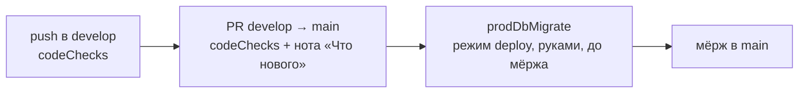

# Actions StudentHub

Шесть прогонов: проверки кода (`codeChecks`), мобильные клиенты (`iOS`, `Android`) и три
ручные операции с базой Railway (`prodDb*`). Список в боковой панели Actions отсортирован
по алфавиту, поэтому группы складываются сами. У каждого прогона в начале файла блок
«СХЕМА ПРОГОНА», а у большинства та же схема попадает в сводку запуска (вкладка
**Summary** открытого прогона) — читать YAML, чтобы понять, что происходит, не нужно.

| Прогон          | Файл           | Когда запускается                                               | Что делает                                                                                                                                                                   |
| --------------- | -------------- | --------------------------------------------------------------- | ---------------------------------------------------------------------------------------------------------------------------------------------------------------------------- |
| `codeChecks`    | `ci.yml`       | push в `develop` и `main`, PR в `main`, ночью в 21:47 UTC       | линт, типы, тесты, сборка, образы (только изменённые: сборка + trivy + запуск), аудит зависимостей и секретов, линт самих прогонов, контракт API, покрытие и размеры бандлов |
| `prodDbMigrate` | `migrate.yml`  | руками                                                          | миграции БД Railway: сначала `status` и SQL глазами, потом `deploy`                                                                                                          |
| `prodDbSeed`    | `seed.yml`     | руками                                                          | наливает полный набор данных без фото и видео под меткой; той же меткой убирает налитое                                                                                      |
| `prodDbReset`   | `reset-db.yml` | руками                                                          | очищает БД до одного администратора. Необратимо                                                                                                                              |
| `iOS`           | `ios.yml`      | push и PR в `develop`/`main` по путям `apps/ios/**`, руками     | сборка iOS-клиента и всех таргетов тестов; тесты — ручным запуском (поле `suites`)                                                                                           |
| `Android`       | `android.yml`  | push и PR в `develop`/`main` по путям `apps/android/**`, руками | сборка, тесты и lint Android-клиента, сверка строк с каталогом iOS                                                                                                           |

## Путь изменения до `main`



Миграции применяются **до** мёржа в `main`: новый код не должен встретить старую схему.
Отката у `prisma migrate` нет — порядок в `docs/RELEASE.md`. PR в `main` остаётся красным,
пока миграции не накатаны (job «Миграции» в `ci.yml`): это единственное, что делается
руками, и намеренно — операция необратимая.

## Ночной прогон и уведомления

CI запускается сам в 21:47 UTC (02:47 по Алматы). Он ищет не ошибку в изменении, а то,
что испортилось само: advisory публикуют после того, как зависимость установлена, а дыру
в базовом образе находят после того, как образ собран. Поэтому ночью собираются все
шесть образов (api, web, landing, mini-app, camera-agent, media-relay), независимо от
того, что менялось.

Сценарии Playwright ночью идут **без повторов** (`PW_RETRIES=0`). Днём один ретрай
спасает от редких таймаутов на медленном раннере, но он же прячет плавающий тест. Ночью
код тот же, что днём, — значит упавшее упало не из-за изменения.

По понедельникам ночной прогон присылает сводку недели: покрытие, размеры бандлов,
число уязвимостей в образах и ссылку на подробности. Это единственное уведомление,
которое приходит, когда всё хорошо.

Уведомление о падении уходит, только когда прогон упал на `main` или ночью: в остальных
случаях человек и так смотрит на галочку. Нужны два секрета:

```
TELEGRAM_BOT_TOKEN   токен бота от @BotFather
TELEGRAM_CHAT_ID     id чата или канала, куда писать
```

Пока их нет, шаг пишет в лог, что пропустил отправку, и прогон остаётся зелёным: он не
должен краснеть из-за ненастроенных уведомлений.

## Что пока измеряется, но не блокирует

Четыре проверки намеренно не красят прогон и только печатают числа в сводку запуска.
Порог, выставленный до того, как увидишь реальные значения, либо краснеет с первого дня
и его начинают обходить, либо стоит так низко, что ничего не значит.

| Проверка         | Что печатает                                         | Когда делать строгой                                       |
| ---------------- | ---------------------------------------------------- | ---------------------------------------------------------- |
| trivy по образам | уязвимости базового образа                           | node уже на 24 LTS — осталось обновить `nginx:1.27-alpine` |
| покрытие тестами | строки, инструкции, функции, ветвления по api и вебу | через несколько недель — порог чуть ниже достигнутого      |
| размер бандлов   | gzip-размер web и mini-app                           | когда прогон несколько раз напечатает размеры прод-сборки  |

Отдельно стоит `oasdiff`: он тоже не блокирует, но по другой причине — ломающее изменение
контракта бывает осознанным, а оба клиента живут в этом же репозитории. При этом сверка
`apps/api/openapi.json` с кодом **блокирует**: схема в git обязана совпадать с тем, что
отдаёт api, как `prisma/schema` с миграциями.

## Почему в Dockerfile'ах нет HEALTHCHECK

Проверка живости образа живёт в прогоне (job «Образ · app»), а не в самом образе, и это
осознанно. Единственный health-эндпоинт api проверяет Prisma, Redis и MinIO разом и
отдаёт 503, если упал любой из трёх. Как `HEALTHCHECK` это означало бы «контейнер
нездоров при моргнувшем Redis» — а на такой сигнал оркестратор перезапускает контейнер,
то есть недоступность кеша превращалась бы в недоступность всего приложения. Railway
использует свой `healthcheckPath` из `railway.json` и `HEALTHCHECK` образа не смотрит.

## Права токена и версии экшенов

У каждого прогона на верхнем уровне задан `permissions: contents: read`. Если job'у
прав не хватает, они добавляются точечно ему, а не всем сразу. Все `checkout` идут с `persist-credentials: false`, иначе токен
остаётся в `.git/config` рабочего каталога и попадает в артефакты и кеши.

Экшены GitHub и Docker пришпилены по тегу, остальные — по SHA с версией в комментарии
(политика в `.github/zizmor.yml`). Обновления приносит dependabot. Проверяет это job
«Прогоны» в `ci.yml`: `actionlint` — синтаксис, выражения и shell внутри `run`,
`zizmor` — права, подстановку ввода в команды и пришпиливание версий.

Прогнать то же локально:

```bash
docker run --rm -v "$PWD":/repo --workdir /repo rhysd/actionlint:1.7.12 -color
docker run --rm -v "$PWD":/repo ghcr.io/zizmorcore/zizmor:1.30.1 \
  --no-progress --config /repo/.github/zizmor.yml /repo/.github/workflows
```

## Зачем прогоны знают о проде

Три прогона `prodDb*` ходят в боевую базу с раннера, а не с ноутбука: у Railway
закрыт прямой доступ к Postgres из части сетей, а у GitHub-раннера egress открыт. Строка
подключения лежит в секрете `DATABASE_PUBLIC_URL` окружения `production`.
Тем же секретом пользуется job «Миграции» в `ci.yml` (на PR в `main` сверяет, применены ли
миграции).
