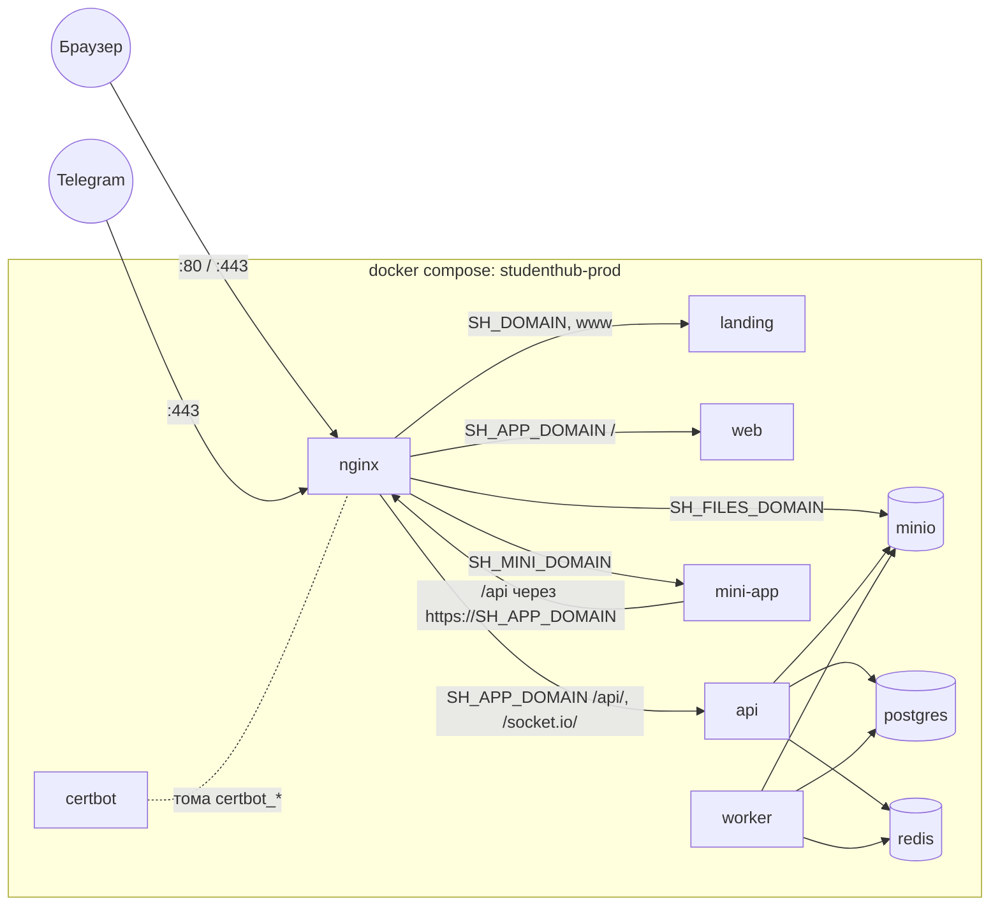
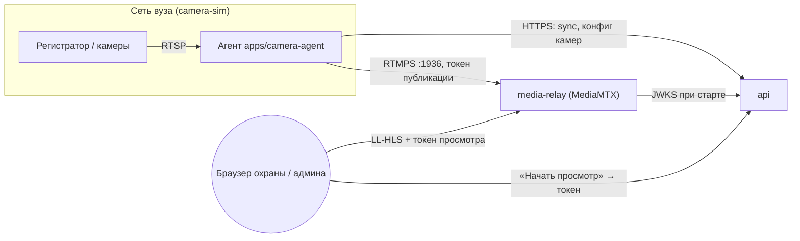

# Инфраструктура StudentHub в `docker/`

Четыре независимых стека docker compose и общие для них базовые сервисы. Здесь — общая
картина: какой стек для чего, как поднять, какие порты, домены и переменные. Детали стеков
камер — в README их каталогов, эксплуатация прода — в `docs/RUNBOOK.md`.

**Где живёт прод.** Боевой прод — сервисы Railway (`docs/RAILWAY.md`), там compose не
используется. `prod/compose.yml` — тот же продукт для самостоятельного хостинга на одной
машине (например, на сервере вуза). Ретранслятор камер на проде — отдельный сервис Railway
из `media-relay/`.

## Карта стеков

| Стек                                    | Для чего                                                      | Когда нужен                                 | Запуск                                                    | Документация                                     |
| --------------------------------------- | ------------------------------------------------------------- | ------------------------------------------- | --------------------------------------------------------- | ------------------------------------------------ |
| [`dev/`](dev/compose.yml)               | postgres, redis, minio, mailpit для `pnpm dev`                | всегда при разработке                       | `pnpm infra:up`                                           | этот файл, «Быстрый старт»                       |
| [`prod/`](prod/compose.yml)             | весь продукт за nginx с TLS: лендинг, web, api, worker, MinIO | самостоятельный хостинг вместо Railway      | `docker compose -f docker/prod/compose.yml up -d --build` | `docs/RUNBOOK.md`, «Прод-стек: первый запуск»    |
| [`camera-sim/`](camera-sim/README.md)   | эмулятор регистратора с камерами в закрытой сети вуза, агент  | модуль камер без железа                     | `pnpm cameras:up`                                         | [`camera-sim/README.md`](camera-sim/README.md)   |
| [`media-relay/`](media-relay/README.md) | ретранслятор видео камер (MediaMTX): агент → браузер          | просмотр камер локально; на проде — Railway | `pnpm relay:up`                                           | [`media-relay/README.md`](media-relay/README.md) |

[`shared/infra.yml`](shared/infra.yml) — не стек, а базовые postgres, redis и minio: dev и
prod подключают их через `extends`.

```
docker/
  README.md            ← вы здесь
  shared/infra.yml     базовые postgres / redis / minio
  dev/                 compose.yml · .env.example · postgres/init/ (создаёт studenthub_test)
  prod/                compose.yml · .env.example · .env.api.example · nginx/
  camera-sim/          compose.yml · nvr.yml · ingest.yml · onvif.yaml · toxiproxy.json · webcam.ps1
  media-relay/         compose.yml · Dockerfile · mediamtx.yml · entrypoint.sh · dev-cert.sh · railway.json
```

## Команды

Из корня репозитория:

| Команда             | Что делает                                                                     |
| ------------------- | ------------------------------------------------------------------------------ |
| `pnpm infra:up`     | поднять dev-стек и дождаться `healthy`; `pnpm infra:up mailpit` — один сервис  |
| `pnpm infra:down`   | остановить dev-стек (тома с данными остаются)                                  |
| `pnpm infra:ps`     | состояние сервисов dev-стека                                                   |
| `pnpm infra:logs`   | логи dev-стека; `pnpm infra:logs minio` — одного сервиса                       |
| `pnpm cameras:up`   | стенд камер: регистратор, вход веб-камеры, плохая сеть                         |
| `pnpm cameras:down` | остановить стенд вместе с профилями `onvif`, `agent`                           |
| `pnpm relay:up`     | собрать и поднять ретранслятор (нужен сертификат, см. `media-relay/README.md`) |
| `pnpm relay:down`   | остановить ретранслятор                                                        |

Прод-стек запускают на сервере руками — порядок в `docs/RUNBOOK.md`.

## Схема

Прод-стек (`prod/compose.yml`):



`worker` берёт медиа-задачи из очереди в redis, которые ставит `api`. Мини-апп ходит к API
через публичный адрес — то есть снова через nginx (см. «Решения»).

Камеры (`camera-sim` — эмулятор того, что стоит в вузе; `media-relay` — ретранслятор):



Видео идёт только пока его смотрят: спрос отмечает api, агент отдаёт поток по нему.
Токены — JWT ES256 от api, ретранслятор проверяет их сам по открытому ключу из JWKS
(`docs/PROJECT.md` §3.10).

## Порты

Все стеки и `pnpm dev` на одной машине — чтобы сразу видеть конфликты. «Интерфейс» — на
каком адресе хоста слушает опубликованный порт; «—» — порт не публикуется, виден только
внутри сети стека.

| Стек        | Сервис                      | Хост                          | Контейнер | Интерфейс                                         |
| ----------- | --------------------------- | ----------------------------- | --------- | ------------------------------------------------- |
| `pnpm dev`  | api                         | 3001                          | —         | процесс на хосте                                  |
| `pnpm dev`  | web                         | 3000                          | —         | процесс на хосте                                  |
| `pnpm dev`  | landing                     | 3002                          | —         | процесс на хосте                                  |
| `pnpm dev`  | mini-app                    | 3003                          | —         | процесс на хосте                                  |
| dev         | postgres                    | `POSTGRES_PORT` = 5432        | 5432      | 127.0.0.1                                         |
| dev         | redis                       | `REDIS_PORT` = 6379           | 6379      | 127.0.0.1                                         |
| dev         | minio (S3)                  | `MINIO_PORT` = 9000           | 9000      | 127.0.0.1                                         |
| dev         | minio консоль               | `MINIO_CONSOLE_PORT` = 9001   | 9001      | 127.0.0.1                                         |
| dev         | mailpit SMTP                | `MAILPIT_SMTP_PORT` = 1025    | 1025      | 127.0.0.1                                         |
| dev         | mailpit UI                  | `MAILPIT_UI_PORT` = 8025      | 8025      | 127.0.0.1                                         |
| prod        | nginx                       | 80, 443                       | 80, 443   | все интерфейсы                                    |
| prod        | postgres                    | `POSTGRES_PORT` = 5432        | 5432      | 127.0.0.1                                         |
| prod        | api                         | —                             | 3001      | —                                                 |
| prod        | web, landing                | —                             | 3000      | —                                                 |
| prod        | mini-app                    | —                             | 8080      | —                                                 |
| prod        | minio                       | —                             | 9000      | — (наружу через nginx)                            |
| prod        | redis                       | —                             | 6379      | —                                                 |
| camera-sim  | ingest                      | `WEBCAM_PUBLISH_PORT` = 18554 | 8554      | 127.0.0.1                                         |
| camera-sim  | bad-network (API Toxiproxy) | `TOXIPROXY_API_PORT` = 8474   | 8474      | 127.0.0.1                                         |
| camera-sim  | nvr, onvif, agent           | —                             | 554, 8080 | — (сеть `campus` 10.77.0.0/24)                    |
| media-relay | HLS                         | `RELAY_HLS_PORT` = 18888      | 8888      | 127.0.0.1                                         |
| media-relay | RTMPS                       | `RELAY_RTMPS_PORT` = 11936    | 1936      | `RELAY_DOCKER_HOST_IP` = 172.17.0.1 (мост Docker) |

Возможные конфликты: dev и prod на одной машине делят 5432 — поменяйте `POSTGRES_PORT`
в одном из `.env`. Если на машине уже работают свои postgres/redis/minio, поднимайте из
dev-стека только нужное (`pnpm infra:up mailpit`) или смените порты в `docker/dev/.env` и
`apps/api/.env`.

Адреса в сети `campus` стенда камер закреплены: nvr — 10.77.0.10, ingest — .20,
bad-network — .30, onvif — .40, agent — .50 (`camera-sim/README.md`).

## Домены прода

**Compose-прод** (`prod/nginx/templates/default.conf.template`). Все имена — A-записями на
машину со стеком, сертификат Let's Encrypt один на все пять:

| Домен                        | Что обслуживает                                                         |
| ---------------------------- | ----------------------------------------------------------------------- |
| `SH_DOMAIN`, `www.SH_DOMAIN` | лендинг; он же `default_server` на 443 — неизвестный Host попадает сюда |
| `SH_APP_DOMAIN`              | платформа: `/` → web, `/api/` → api, `/socket.io/` → api (WebSocket)    |
| `SH_FILES_DOMAIN`            | MinIO: браузер кладёт и забирает файлы по presigned-ссылкам             |
| `SH_MINI_DOMAIN`             | мини-апп администраторов в Telegram                                     |

На 80-м порту — только проверка Let's Encrypt (`/.well-known/acme-challenge/`) и редирект
на HTTPS.

**Railway** (`docs/RAILWAY.md`): у каждого сервиса свой домен — `api.<домен>` (api),
`app.<домен>` (web), корневой (лендинг), домен Railway у мини-аппа, а у ретранслятора —
HTTP-домен для HLS и TCP-прокси `<хост>.proxy.rlwy.net:<порт>` для RTMPS. Поэтому адреса API
там и в compose-проде разные: `https://api.<домен>/api/v1` против
`https://app.<домен>/api/v1`.

## Быстрый старт

От клонирования до работающего API. Нужны Node.js 24+, pnpm 10, Docker.

1. Зависимости:

   ```bash
   git clone git@github.com:startupjafari/studenthub.git && cd studenthub
   pnpm install
   ```

2. Переменные dev-стека — задайте пароли `POSTGRES_PASSWORD`, `REDIS_PASSWORD`,
   `MINIO_ROOT_USER`, `MINIO_ROOT_PASSWORD` (последний — не короче 8 символов):

   ```bash
   cp docker/dev/.env.example docker/dev/.env
   ```

3. Инфраструктура — команда ждёт, пока все четыре сервиса станут `healthy`:

   ```bash
   pnpm infra:up
   ```

4. Переменные api — те же пароли, что в шаге 2, плюс три секрета:

   ```bash
   cp apps/api/.env.example apps/api/.env
   ```

   | В `apps/api/.env`                                                | Значение                                     |
   | ---------------------------------------------------------------- | -------------------------------------------- |
   | `DATABASE_URL`, `DATABASE_URL_TEST`                              | `password` → `POSTGRES_PASSWORD`             |
   | `REDIS_PASSWORD`                                                 | как в `docker/dev/.env`                      |
   | `MINIO_ACCESS_KEY`, `MINIO_SECRET_KEY`                           | `MINIO_ROOT_USER`, `MINIO_ROOT_PASSWORD`     |
   | `JWT_ACCESS_SECRET`, `JWT_REFRESH_SECRET`, `TOTP_ENCRYPTION_KEY` | по `openssl rand -base64 48` на каждый       |
   | `SMTP_HOST`, `SMTP_PORT`                                         | `localhost`, `1025` — письма будут в mailpit |

5. Схема базы и демо-данные (Prisma и сид сами читают `apps/api/.env`):

   ```bash
   pnpm db:deploy
   pnpm db:seed
   ```

6. API:

   ```bash
   pnpm --filter api dev
   ```

7. Проверка — `database`, `redis` и `minio` должны быть `up`:

   ```bash
   curl -s http://localhost:3001/api/v1/health
   ```

Дальше — `pnpm dev` для api и web вместе (`apps/web/.env.local` из `.env.example`), вход
`admin@studenthub.app` / `Admin1234!`. Письма — http://localhost:8025, консоль MinIO —
http://localhost:9001.

## Переменные окружения

Какой файл кто читает:

| Файл                      | Кто читает                                                              | Образец                        |
| ------------------------- | ----------------------------------------------------------------------- | ------------------------------ |
| `docker/dev/.env`         | docker compose dev-стека                                                | `docker/dev/.env.example`      |
| `apps/api/.env`           | api в `pnpm dev`, Prisma (`pnpm db:*`), сид, e2e                        | `apps/api/.env.example`        |
| `apps/web/.env.local`     | web в `pnpm dev` и при сборке                                           | `apps/web/.env.example`        |
| `docker/prod/.env`        | docker compose прод-стека: подстановка в `compose.yml`                  | `docker/prod/.env.example`     |
| `docker/prod/.env.api`    | контейнеры api и worker (`env_file`)                                    | `docker/prod/.env.api.example` |
| `docker/camera-sim/.env`  | compose стенда камер; необязателен — у всего есть значения по умолчанию | `camera-sim/README.md`         |
| `docker/media-relay/.env` | compose ретранслятора; необязателен                                     | `media-relay/compose.yml`      |

Все `.env.example` в `docker/` устроены одинаково: группа → переменная → над ней строка
«обязательна или по умолчанию · кто читает · подсказка».

Неочевидное — откуда переменная попадает в процесс:

| Переменные                        | Как доходят                                                                                                                                                                                              | Что из этого следует                                                                                                                        |
| --------------------------------- | -------------------------------------------------------------------------------------------------------------------------------------------------------------------------------------------------------- | ------------------------------------------------------------------------------------------------------------------------------------------- |
| `NEXT_PUBLIC_*`                   | вшиваются в JS-бандл при `next build`: в compose-проде — аргументами сборки (`build.args`), на Railway — переменными сервиса во время сборки                                                             | правка требует пересборки (`up -d --build`, ре-деплой), рестарт ничего не меняет; в compose-проде web получает только `NEXT_PUBLIC_API_URL` |
| `MTX_*`                           | MediaMTX читает их поверх своего yml: `MTX_AUTHJWTJWKS` → `authJWTJWKS`, `MTX_AUTHINTERNALUSERS_1_PASS` → пароль второго пользователя. `media-relay/entrypoint.sh` сам задаёт `MTX_HLSADDRESS` из `PORT` | значения в yml вроде `overridden-by-env` — заглушки, настоящие задаёт окружение                                                             |
| `SH_*`                            | compose подставляет их в `prod/compose.yml` (CORS MinIO, `API_TARGET` мини-аппа, адреса у api) и передаёт nginx; образ nginx прогоняет `templates/*.template` через envsubst при старте                  | `NGINX_ENVSUBST_FILTER='^SH_'` — подставляются только наши имена, `$host` и `$uri` nginx не трогаются                                       |
| `API_TARGET`, `PORT` мини-аппа    | envsubst в nginx-шаблоне образа мини-аппа (`apps/mini-app/nginx.conf.template`)                                                                                                                          | `API_TARGET` — публичный адрес, не имя сервиса (см. «Решения»)                                                                              |
| `RELAY_TLS_CERT`, `RELAY_TLS_KEY` | `media-relay/entrypoint.sh` пишет их в `/certs` при старте; без них берётся смонтированный `/certs`                                                                                                      | PEM — одной строкой с `\n`, как переменные Railway                                                                                          |
| адреса стека у api в проде        | `x-api` в `prod/compose.yml`: `REDIS_HOST`, `MINIO_*`, `CORS_ORIGIN`, `APP_PUBLIC_URL`, `TRUST_PROXY`, `PORT`                                                                                            | перекрывают `.env.api` — правка там не подействует                                                                                          |

### Переход со старого `docker/.env`

Раньше dev и prod читали один `docker/.env`. Теперь:

- **dev** — `mv docker/.env docker/dev/.env`; строки прод-секции можно удалить.
- **prod** — файл переезжает в `docker/prod/.env`, из него остаются домены, `CERTBOT_EMAIL`,
  `POSTGRES_*`, `REDIS_PASSWORD`, `MINIO_ROOT_*`, `NEXT_PUBLIC_*`. Переменные приложения
  (`DATABASE_URL`, `JWT_*`, `TOTP_ENCRYPTION_KEY`, `MINIO_ACCESS_KEY`, `MINIO_SECRET_KEY`, SMTP,
  Sentry, APNs, VAPID, Telegram …) — в новый `docker/prod/.env.api`. `REDIS_HOST`,
  `MINIO_ENDPOINT`, `MINIO_USE_SSL`, `MINIO_PUBLIC_*`, `CORS_ORIGIN`, `APP_PUBLIC_URL`,
  `TRUST_PROXY`, `PORT`, `NODE_ENV` и порты dev-секции удалить: их задаёт compose или образ.

## Частые проблемы

- **MinIO не стартует** — `MINIO_ROOT_PASSWORD` короче 8 символов.
- **`pull access denied` / 401 на образе MinIO** — официальные `minio/minio` и
  `quay.io/minio/minio` больше не раздаются. Стеки берут `pgsty/minio`; старый тег живёт
  только в локальном кэше docker.
- **Сменили `NEXT_PUBLIC_*`, а сайт показывает старое** — эти переменные вшиваются при
  сборке: `up -d --build` в compose, ре-деплой на Railway.
- **`port is already allocated`** — порт занят другим процессом или стеком (таблица «Порты»).
  Поменяйте его в `docker/dev/.env`, а для postgres/redis/minio — ещё и в `apps/api/.env`.
- **Нет базы `studenthub_test`** — `postgres/init` выполняется только на пустом томе. Создать
  руками: `docker compose -f docker/dev/compose.yml exec postgres createdb -U postgres studenthub_test`.
- **Прод: nginx не стартует** — нет сертификата. Первый выпуск — разовой командой до старта
  nginx (`docs/RUNBOOK.md`); пока сертификата нет, nginx не поднимается.
- **Прод: файлы не грузятся, `SignatureDoesNotMatch`** — подпись считается по Host. Ссылки
  должны вести на `SH_FILES_DOMAIN`, а nginx не должен подменять заголовок Host.
- **Ретранслятор отвергает токены** — сменили `MEDIA_JWT_PRIVATE_KEY` у api: ретранслятор
  забирает ключ один раз при старте, перезапустите его. Плеер не грузит видео с прода —
  проверьте `MTX_HLSALLOWORIGINS` (origin веба).
- **`.env` с PEM не читается через `set -a && . apps/api/.env`** — сертификаты и ключи
  пишутся одной строкой с `\n` и в одинарных кавычках: в PEM есть пробелы.
- **Агент стенда не достаёт ретранслятор** — RTMPS опубликован на мосту Docker
  `172.17.0.1`. Если мост другой (Docker Desktop, своя сеть), задайте `RELAY_DOCKER_HOST_IP`.
- **Регистратор стенда отвечает с хоста** — хост Docker всегда видит свои сети. Изоляцию
  сети `campus` проверяйте из контейнера, а не с хоста.

## Решения

Почему конфигурация устроена именно так. Комментарии в файлах ссылаются сюда.

**Порты dev-стендов — только на 127.0.0.1.** Это машина разработчика: база и хранилище не
должны слушать внешний интерфейс. `pnpm dev` ходит к ним с того же хоста, так что ничего не
теряется. Исключение — RTMPS ретранслятора на адресе моста Docker: агенту из контейнера
стенда он виден, локальной сети — нет.

**Базовые сервисы в `shared/infra.yml`, стеки — через `extends`.** Образ, команда запуска,
переменные и проверка postgres, redis и minio одинаковы в dev и prod. Раньше они были
скопированы в два файла и разъезжались: у прод-redis, например, не было пароля в окружении,
и его healthcheck не проходил никогда. Своё у стека — порты, `restart`, логи и частота
проверок.

**MinIO — образ `pgsty/minio`.** MinIO прекратил раздачу community-образов: `minio/minio`
удалён с Docker Hub, на quay.io анонимный pull запрещён. `pgsty/minio` собирается из
исходников, запускается той же командой с теми же `MINIO_ROOT_*` и томом. Тег закреплён.
Переход с версии 2025-04 на 2026-08 — обновление вперёд; откатить данные на старый образ
нельзя.

**Без `container_name`.** Compose и так даёт уникальные имена `<проект>-<сервис>-1`
(`studenthub-postgres-1`, `studenthub-prod-api-1`), а заданное имя запрещает `--scale` и
ломает второй клон репозитория на той же машине. К контейнерам обращаемся через
`docker compose exec <сервис>`.

**Порядок ключей в сервисе:** `extends`/`profiles` → `image`/`build` →
`command`/`entrypoint` → `restart` → `logging` → `env_file`/`environment` → `depends_on` →
`ports`/`expose` → `volumes` → `extra_hosts`/`mac_address`/`networks` → `healthcheck`.

**api и worker — один образ.** `api` собирает `studenthub-prod-api`, `worker` запускает его
же с командой `node dist/worker.js`. Раньше один Dockerfile собирался дважды. Отдельный
`worker` нужен, чтобы ffmpeg (варианты изображений, постеры, HLS) не делил CPU с
HTTP-запросами: api в этой конфигурации идёт с `MEDIA_PROCESSING=worker` и только ставит
задачи. Порт worker не слушает, поэтому healthcheck у него нет.

**Адреса стека у api задаёт compose, а не `.env.api`.** `REDIS_HOST=redis`,
`MINIO_ENDPOINT=minio`, публичный адрес MinIO, `CORS_ORIGIN`, `APP_PUBLIC_URL` однозначно
следуют из устройства стека и доменов. Заданные руками, они расходились бы с nginx и
сертификатом. `TRUST_PROXY` включает `uniquelocal`: nginx стоит в сети docker, и без этого
api считал бы клиентом сам прокси.

**Ротация логов docker** — `json-file` по 10 МБ, 5 файлов на сервис. Без неё лог растёт до
размера диска: api пишет строку pino на каждый запрос, и стек однажды встаёт не из-за
ошибки в коде, а из-за кончившегося места.

**Живость приложений — TCP-коннект, а не `/health`.** Health-эндпоинт api проверяет Prisma,
Redis и MinIO разом и отдаёт 503, если моргнул любой из них. Как healthcheck это значило бы,
что при недоступном кеше стек не поднимается вовсе: nginx ждёт api по `service_healthy` и не
дождался бы. Проверяется ровно то, что нужно для старта, — процесс слушает свой `PORT`.
Подробнее — `.github/workflows/README.md`, «Почему в Dockerfile'ах нет HEALTHCHECK».

**Миграции — отдельно, до старта api.** Стек их не применяет. CLI Prisma — dev-зависимость
корня репозитория, в образ api не попадает, поэтому postgres опубликован на петле хоста:
`pnpm db:deploy` и `pg_dump` идут с самой машины (`docs/RUNBOOK.md`).

**MinIO за отдельным доменом.** Браузер ходит в хранилище напрямую: api подписывает
presigned-ссылки на `SH_FILES_DOMAIN`, и файлы больше 10 МБ идут в MinIO мимо api. Внутреннее
имя `minio` снаружи не резолвится — без этого домена загрузка и скачивание не работают. CORS
у MinIO разрешён только origin платформы: подпись и так обязательна, но незачем позволять
любому сайту дёргать хранилище из вкладки пользователя.

**Лимиты тела в nginx.** Через `/api/` проходит не больше 10 файлов по 10 МБ — так ограничен
multipart у api (`FILE_UPLOAD.DIRECT_UPLOAD_THRESHOLD_BYTES`, `apps/api/src/main.ts`), отсюда
`client_max_body_size 110m`. На домене файлов лимит снят совсем: сколько можно загрузить,
решает api, когда подписывает ссылку. Буферизация там выключена — иначе nginx принимал бы
весь файл на диск прежде, чем отдать его MinIO. Заголовок Host на домене файлов не
подменяется: подпись SigV4 считается и по нему.

**web без `API_PROXY_TARGET`.** Запросы `/api/*` в compose-проде проксирует nginx, а не сам
web, поэтому `NEXT_PUBLIC_API_URL` — путь на домене платформы, `https://<SH_APP_DOMAIN>/api/v1`.

**Лендинг без `depends_on`.** У него нет ни общего кода, ни общих данных с платформой
(`docs/LANDING.md`): если web лежит, лендинг продолжает отдаваться, а его редиректы на
платформу просто ведут в недоступный сервис.

**Мини-апп ходит к API по публичному адресу.** Его nginx резолвит цель внешним DNS
(`resolver` в `apps/mini-app/nginx.conf.template`), и имя `api` из сети compose он не найдёт.
`API_TARGET=https://<SH_APP_DOMAIN>` — запрос идёт через тот же nginx, что и остальной трафик.
Отдельный домен нужен потому, что Telegram открывает мини-апп в WebView и требует https.

**TLS и HSTS — в nginx.** Это единственная точка терминации TLS в compose-проде, поэтому
политика TLS задана один раз на весь `http`-блок, а HSTS — в каждом `server`. Редирект с 80
на 443 защищает только тех, кто уже пришёл по http: первый запрос по привычному адресу всё
равно уходит открытым. `always` — чтобы заголовок был и в ответах с ошибкой.
`default_server` на 443 — лендинг: запрос с неизвестным Host попадает на публичный сайт, а
не внутрь платформы.

**Сертификат один на пять имён.** certbot кладёт его в каталог по первому `-d`, поэтому в
путях шаблона стоит `${SH_DOMAIN}` и порядок имён при выпуске важен. Первый выпуск — в
режиме standalone на свободном 80-м порту: без сертификата nginx не стартует, а пока он не
поднялся, webroot-проверку отдавать некому. Дальше сервис `certbot` раз в 12 часов делает
`renew` через общий с nginx том `certbot_www`, а nginx раз в 6 часов делает `reload`: новый
сертификат попадает в запущенный процесс только так. Без reload TLS протух бы через 90 дней
при исправно работающем продлении.

**JWKS ретранслятора — адрес зависит от способа деплоя.** Ретранслятор забирает открытый
ключ у api по `MTX_AUTHJWTJWKS`:

| Где api                      | `MTX_AUTHJWTJWKS`                                                                    |
| ---------------------------- | ------------------------------------------------------------------------------------ |
| Railway                      | `https://api.<домен>/api/v1/.well-known/media-jwks.json`                             |
| compose-прод                 | `https://<SH_APP_DOMAIN>/api/v1/.well-known/media-jwks.json`                         |
| разработка (`pnpm relay:up`) | `http://host.docker.internal:3001/api/v1/.well-known/media-jwks.json` — по умолчанию |

Сам ретранслятор в compose-прод не входит: на проде это сервис Railway.
