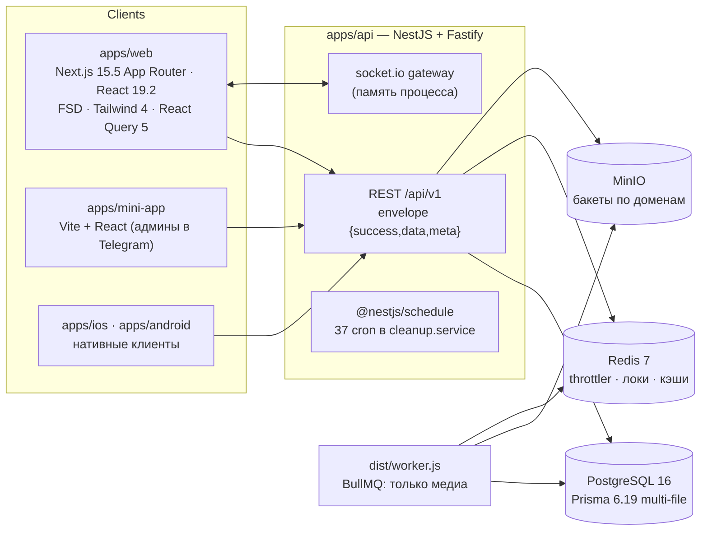
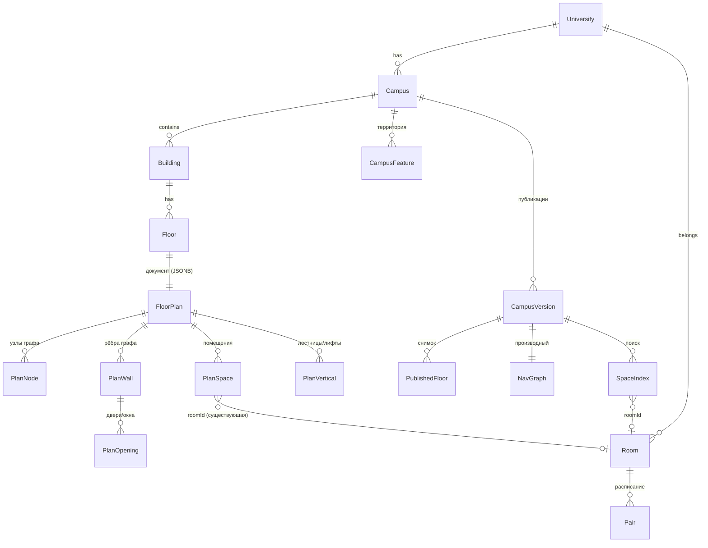
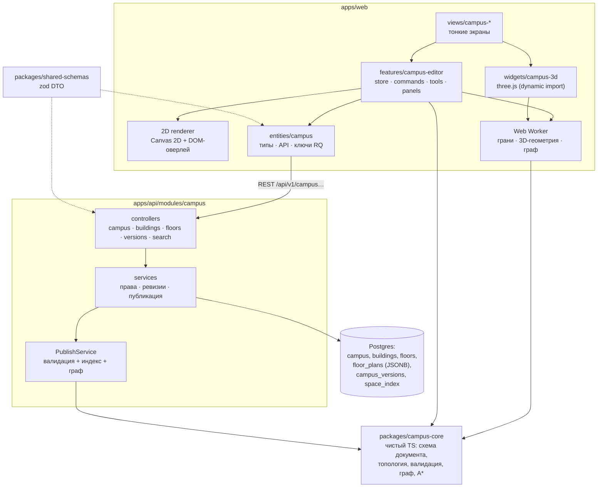
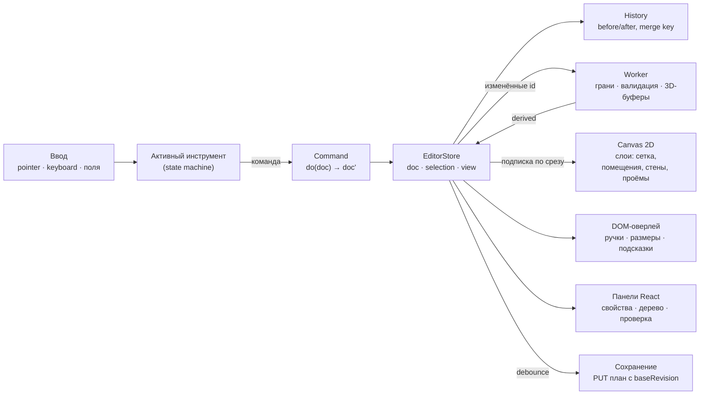
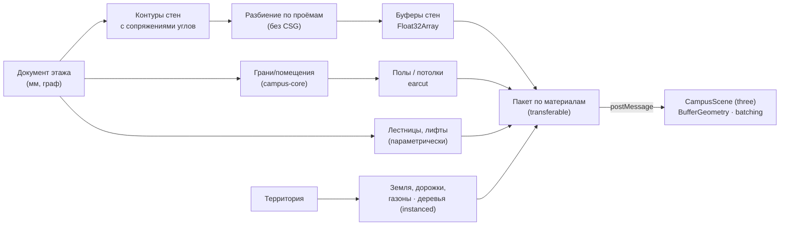
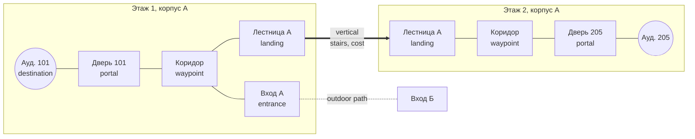
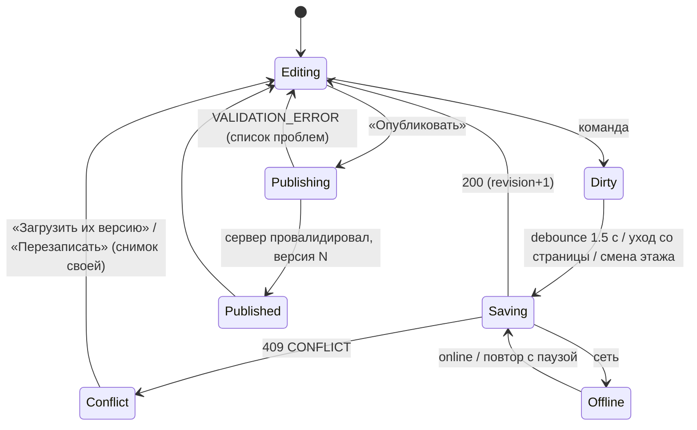

# StudentHub Campus 3D Builder — архитектурный и продуктовый план

> Статус: **план, не реализация.** Составлен 04.11.2026 по аудиту репозитория (ветка `develop`).
> Решения владельца по открытым вопросам приняты 04.11.2026 — раздел 27.1; план под них
> обновлён.
> Код, зависимости, миграции и инфраструктура этим документом не меняются.
>
> Документ — для разработчиков и агентов, которые будут вести эпик по задачам. Каждая задача
> раздела 24 рассчитана на одну сессию агента и один PR, как остальные фазы
> `docs/IMPLEMENTATION_PLAN.md` (§0.1). Предлагаемый номер эпика в плане — **Фаза 22**.
>
> Почему файл здесь, а не в `docs/plans/`: в репозитории нет папки `docs/plans/` и папки ADR,
> вся документация лежит плоско в `docs/` с именами в верхнем регистре (`PROJECT.md`,
> `BACKEND_RULES.md`, `DESIGN_SYSTEM.md`…). План следует этой структуре; ADR — раздел 26 этого же
> файла, отдельные ADR-файлы заводить незачем, пока их не больше десятка.

## Оглавление

1. Executive Summary
2. Current StudentHub Architecture
3. Repository Audit Findings
4. Product Vision
5. Scope and Non-Goals
6. Domain Model
7. System Architecture
8. Technology Evaluation
9. Chosen Stack
10. Data Architecture
11. Geometry Architecture
12. 2D Editor Architecture
13. Procedural 3D Architecture
14. Campus Territory Architecture
15. Navigation Architecture
16. UX/UI Architecture
17. StudentHub Integrations
18. API Design
19. Permissions and Security
20. Saving and Versioning
21. Performance Strategy
22. Testing Strategy
23. MVP Scope
24. Phased Implementation Plan
25. Risk Register
26. Architecture Decisions (ADR-001…ADR-012)
27. Open Questions
28. Recommended First Development Task

---

## 1. Executive Summary

**Что строим.** Внутри StudentHub — редактор, в котором администратор вуза без CAD и 3D-навыков
рисует 2D-планы этажей (стены, помещения, двери, лестницы), а система сама строит 3D-модель,
поиск помещений и маршруты. Результат — структурированный цифровой двойник кампуса для
навигации, а не BIM и не фотореализм.

**Главные решения.**

| Решение | Суть |
|---|---|
| Источник истины | 2D-топология этажа (планарный граф стен + помещения) в целых **миллиметрах**; 3D — производное, никогда не хранится как Mesh |
| Связь с вузом | Существующая модель `Room` (`prisma/schema/02-academic.prisma:141`) остаётся бизнес-сущностью помещения (расписание, QR, камеры, экзамены). Новый `Space` — её геометрия; связь `Space.roomId → Room.id` |
| Хранение | Реляционно — то, на что ссылаются (кампус, корпус, этаж, помещение-индекс, версии); документом JSONB — геометрия этажа с ревизией для оптимистичной конкуренции |
| Публикация | Неизменяемая версия кампуса: снимок этажей + производный индекс помещений + навигационный граф, фильтруемый по уровню доступа зрителя |
| 2D-движок | Свой рендер на Canvas 2D + DOM-оверлей для ручек и полей ввода; без Konva/Pixi |
| 3D-движок | **three.js** напрямую (без React Three Fiber), только через dynamic import на экранах 3D |
| Геометрия | Свой пакет `packages/campus-core` (чистый TS, общий для web и api): топология, валидация, грани, навигационный граф. Внешняя зависимость — только **earcut** (триангуляция) |
| Вычисления | Web Worker на нативном `postMessage`, без Comlink и WASM |
| Маршруты | A* на клиенте по опубликованному графу; сервер граф строит и фильтрует, но маршрут не считает |
| Права | Существующие роли: редактируют и публикуют `UNIVERSITY_ADMIN` и `UNIVERSITY_MODERATOR` своего вуза (+ `PLATFORM_ADMIN`), смотрят все члены вуза; видимость помещений — уровнем доступа |
| Подложки | Нет никаких: ни внешней карты, ни загруженного изображения. План и территорию рисуют с нуля |
| Планшет | Полноценное рисование стен пальцем и пером, а не только просмотр |

**MVP.** Рекомендуется **MVP-A** (раздел 23): кампус → один и более корпусов → этажи → стены →
помещения автоматически → двери, окна → номера и обязательная для учебных помещений связь с
`Room` → лестница между этажами →
сохранение с ревизиями → процедурное 3D → публикация → поиск помещения и «Показать на карте» из
расписания. Маршруты (MVP-B) — следующим релизом: у них своя топологическая сложность, и без
неё MVP уже даёт ценность.

**Первая задача.** `22.1 — packages/campus-core: формат документа этажа и топология` —
чистый TypeScript без UI, БД и внешних зависимостей, полностью покрываемый unit-тестами
(раздел 28).

---

## 2. Current StudentHub Architecture

Подтверждено аудитом (пути от корня репозитория).



| Слой | Технология и версия | Где видно |
|---|---|---|
| Монорепо | Turborepo ^2.5.8, pnpm 10.33.2 (`minimumReleaseAge: 10080` — новые версии пакетов ставятся через 7 дней), Node ≥24 | `package.json`, `pnpm-workspace.yaml`, `.nvmrc` |
| Web | Next 15.5.28, React 19.2.8, TypeScript 5.9.3, Tailwind 4.3, radix-ui 1.6.7, lucide-react 0.548, next-intl 4.13 (ru/kk/en), next-themes 0.4.6 | `apps/web/package.json` |
| Данные на клиенте | TanStack Query 5 (фабрики ключей в `entities/*/api`), Redux Toolkit только `auth` + `ui` | `src/shared/api/query-client.ts`, `src/shared/store/store.ts` |
| Формы | react-hook-form 7 + zod 3.25 из `packages/shared-schemas` | FRONTEND_RULES §7 |
| API | NestJS + Fastify, nestjs-zod 4.3, глобальный `ZodValidationPipe` | `apps/api/src/common/common.module.ts:17` |
| БД | PostgreSQL 16, Prisma 6.19, схема в `prisma/schema/*.prisma` | `docker/shared/infra.yml:8` |
| Очереди | BullMQ (`email`, `notifications`, `file-processing`, `link-preview`, `media-image`, `media-video`) | `apps/api/src/common/queue/queue.constants.ts` |
| Realtime | socket.io, комнаты `user:` `group:` `university:`, конверт `{type,entityId,version,ts,data}` | `apps/api/src/common/realtime/realtime.gateway.ts` |
| Хранилище | MinIO, бакеты на домен, presigned PUT/GET, multipart | `apps/api/src/modules/files/file.service.ts` |
| Деплой | Railway, Docker `node:24-alpine`, миграции вне образа через GitHub Actions | `docs/RAILWAY.md` §5 |

---

## 3. Repository Audit Findings

### 3.1 Подтверждённые факты

**Пространство и помещения.**

- Единственная пространственная сущность — `Room` (`prisma/schema/02-academic.prisma:141-174`,
  таблица `rooms`). Поля:
  - `id` (uuid), `name` (1–100 знаков, **не уникально** в вузе), `capacity?`;
  - `universityId`, `kind RoomKind`;
  - `building String?` (свободный текст), `floor Int?` (−5..100);
  - `openHours?`, `phone?`, `info?`, `qrCode @unique`, `qrIssuedAt`.
- У `Room` нет `deletedAt`, `facultyId`, геометрии и версии. Индекс один — `@@index([universityId])`.
- `RoomKind` (`_enums.prisma:123-136`, `shared-schemas/src/rooms.ts:11-32`):
  - учебные: `AUDITORIUM`, `LAB`, `SPORT_HALL`;
  - неучебные: `LIBRARY`, `ASSEMBLY_HALL`, `ADMIN_OFFICE`, `DEAN_OFFICE`, `ACCOUNTING`, `CANTEEN`,
    `DORMITORY`, `OTHER`.
- На `Room` ссылаются по FK (везде `onDelete: SetNull`):
  - `Pair.roomId` (`03-schedule.prisma:42`, индекс `[roomId, dayOfWeek]`);
  - `ScheduleChange.newRoomId` (`:81`);
  - `Exam.roomId` (`21-exams.prisma:12`);
  - `Camera.roomId` (`33-cameras.prisma:43`).
- Свободным текстом, без FK:
  - `Event.location` (`07-events.prisma:26`), `ConsultationSlot.location` (`22-consultations.prisma:10`);
  - `User.officeRoom` (`01-users.prisma:114`), `Application.pickupLocation`.
- Помещения уже управляются и печатаются (Фаза 16):
  - CRUD `/rooms` с `@Roles(PLATFORM_ADMIN, UNIVERSITY_ADMIN)` (`apps/api/src/modules/rooms/rooms.controller.ts:38-130`);
  - QR-наклейки и страница `/r/<код>` (`apps/web/src/app/(student)/r/[code]/page.tsx`);
  - экран администратора `/university-admin/rooms`;
  - печать пачкой по корпусу и этажу (`apps/web/src/views/rooms/ui/print-batch-modal.tsx:38-72`).
- Сервис расписания проверяет помещение через `rooms.assertRoomInUniversity`
  (`apps/api/src/modules/rooms/rooms.service.ts:243`). Конфликты пар он ловит по группе,
  преподавателю и помещению (`schedules.service.ts:869-918`).
- В вебе пара показывает помещение как `{id, name}`: `const room = change?.newRoom ?? pair.room`
  (`apps/web/src/widgets/schedule-grid/ui/pair-detail-modal.tsx:66`, `widgets/today/ui/next-pair-card.tsx:62`).

**Нет:**

- моделей Campus/Building/Floor/Department;
- координат и lat/lng;
- PostGIS (в 138 миграциях нет `CREATE EXTENSION`);
- карт, 3D- и геометрических библиотек в lockfile (three, R3F, konva, pixi, earcut, turf,
  clipper, maplibre, leaflet).

**Структура вуза и мультиарендность.**

- `University → Faculty → Group`: у `Group` нет прямого `universityId`, он берётся через факультет.
  Модели кафедры нет (`User.department` — строка).
- Scope берётся только из JWT `{sub, role, universityId, facultyId, groupId, companyId?}`
  (`apps/api/src/common/auth/jwt-payload.type.ts`). Каждый сервис перепроверяет его сам: шаблон —
  `assertManageScope` в `rooms.service.ts:299-312`.
- Порядок глобальных guard'ов: Jwt → Maintenance → MiniApp → RestrictedRole → Roles →
  ActionConfirm → Scope → TwoFactor (`apps/api/src/modules/auth/auth.module.ts:61-79`). Маршрут
  без `@Roles` открыт любому вошедшему.
- `RESTRICTED_ROLES = [SECURITY_GUARD, LIBRARIAN]` по умолчанию запрещены. Маршрут для них
  открывают явно: `@RestrictedAllowed`.
- Общей таблицы ACL нет. Есть доменные таблицы доступа: `DocumentAccess`, `CompanyMember`,
  `CompanyUniversityAccess`, `CameraSettings` / `LibrarySettings` (включение модуля на вуз).

**Конвенции API.**

- Ответы:
  - префикс `api/v1`;
  - конверт `{success, data, meta}`;
  - ошибки `AppException(code, …)` с кодами из `packages/shared-types/src/error-codes.ts`
    (`WRONG_SCOPE` 403, `CONFLICT` 409, `VALIDATION_ERROR` 422).
- Запросы:
  - DTO через `createZodDto(Schema)` из `packages/shared-schemas`;
  - пагинация — offset (`OffsetPaginationSchema`) или keyset (`apps/api/src/common/http/keyset-cursor.ts`);
  - `findMany` без `take` запрещён (`BACKEND_RULES.md` §5.3).
- Контракт: `apps/api/openapi.json` лежит в репозитории, CI сравнивает его с кодом.
- Защита и журнал:
  - throttler в Redis, глобально 100 запросов в минуту на пользователя;
  - аудит явно через `AuditService.record`, хранится 90 дней.
- **Лимит JSON-тела Fastify не задан → действует 1 MiB по умолчанию** (`apps/api/src/main.ts:55-81`).
- **Оптимистической конкуренции в проекте нет**: поля `version`, `If-Match` и ETag на доменных
  сущностях не встречаются. Вместо них:
  - advisory-локи `advisoryXactLock` (`apps/api/src/common/prisma/advisory-lock.ts`);
  - `SELECT … FOR UPDATE`;
  - повторы при нарушении уникальности.
- JSONB уже используется для структурированных документов:
  - `Story.elements` — проверка через zod на записи и защитный разбор на чтении
    (`stories.service.ts:164-170`);
  - `Application.formData`.
- Ближайший аналог версионируемого документа — `Schedule`: одна активная версия на группу, новая
  создаётся черновиком. Таблиц ревизий и снимков нет.

**Фронтенд.**

- FSD со строгим направлением импортов app → views → widgets → features → entities → shared
  (FRONTEND_RULES §2.1).
- Тяжёлое (графики, редакторы, «карты») грузится только через `next/dynamic({ ssr:false })`,
  таких мест около 44. Рост бандла больше чем на 15% нужно обосновать (FRONTEND_RULES §4, §11).
- Бюджет бандла: `.size-limit.json` только отчитывается, порога нет. Средний маршрут — 598 kB,
  самый тяжёлый — 787 kB (`docs/PERF_BASELINE.md:308-330`).
- **Переиспользуемые части редактора сторис** (`apps/web/src/features/create-story`):
  - `model/use-editor-history.ts`: undo/redo — 100 шагов, слияние шагов с одним ключом за 800 мс;
  - горячие клавиши Ctrl/⌘+Z, Shift+Z / Y, Delete, Esc (`create-story-form.tsx:500-527`);
  - сетка «инструменты · холст · панель» `lg:grid-cols-[220px_1fr_280px]`, панель уходит в шторку
    ниже `lg` (`create-story-form.tsx:657-815`);
  - безопасные зоны и направляющие при перетаскивании (`ui/story-canvas.tsx:393-400`).
- **Общие примитивы:**
  - жесты pan/pinch/zoom к курсору — `src/shared/lib/use-crop-gestures.ts`;
  - пружины без библиотек — `spring.ts`;
  - токены анимаций — `motion.ts`;
  - полноэкранная оболочка редактора — `src/shared/ui/media-editor-shell.tsx`.
- Меню:
  - навигация по ролям — `src/widgets/app-shell/model/nav.ts` (583 строки);
  - у администратора вуза уже есть раздел `buildings` с пунктами «Помещения» и «Камеры» (`:165-175`).
- Тема: next-themes (`class`, по умолчанию system), токены в oklch (`src/app/globals.css`).
- CSP (`apps/web/next.config.mjs`):
  - `worker-src 'self' blob:` — воркеры можно;
  - `script-src` без `'unsafe-eval'` и **без `'wasm-unsafe-eval'`** — WASM сейчас нельзя;
  - `Permissions-Policy: geolocation=()` — **геолокация заблокирована**.
- PWA: манифест `orientation: portrait-primary`.
- Тесты:
  - Vitest + jsdom, моков canvas и WebGL нет (`vitest.setup.ts`);
  - Playwright, проекты `chromium` и `ui-audit` на 7 ширинах.
- i18n: каждый ключ в трёх локалях, это проверяет `src/shared/i18n/messages.test.ts`.

### 3.2 Предположения

- Объём кампуса у целевых вузов — до десятков корпусов по 3–10 этажей. На это рассчитаны
  оценки производительности (раздел 21). Реальных планов пилотов нет — гипотезы проверяются на
  тестовом кампусе и генераторе (раздел 22.1).
- ~~Администраторы будут рисовать поверх фотографии эвакуационного плана.~~ Владелец решил:
  подложек нет, план рисуют с нуля по размерам (раздел 27.1). Поэтому точный ввод размеров
  числами и привязки (раздел 12.4) важнее, чем в редакторе «по картинке».
- Вузу важнее «найти аудиторию и этаж», чем точный маршрут. Это и обосновывает MVP-A.

### 3.3 Требует проверки

| Вопрос | Как проверить |
|---|---|
| Версия Postgres на Railway и наличие PostGIS | Railway → сервис БД. План PostGIS **не требует** |
| ~~Сжимает ли API ответы (gzip/br)~~ | Решено владельцем: сжатие в проде включено |
| ~~Можно ли поднять `bodyLimit` на одном маршруте~~ | Решено владельцем: да, 2 MiB на маршруте сохранения плана. Способ (конфиг маршрута Fastify в Nest) — проверить в задаче 22.5 |
| Как ведёт себя Safari iOS на `OffscreenCanvas` и WebGL2 | Для MVP не обязателен: 3D работает на WebGL1/2 через three, 2D — в главном потоке |
| Нужна ли таблица сканирований QR (продолжение Фазы 16) | Продуктовое решение, к эпику не относится |

---

## 4. Product Vision

**Пользователи и задачи.**

| Кто | Что делает | Экран |
|---|---|---|
| Администратор вуза (`UNIVERSITY_ADMIN`) | Создаёт кампус и корпуса, рисует этажи, связывает помещения с `Room`, публикует | `/university-admin/campus` и редактор |
| Студент, староста, преподаватель, декан | Ищет аудиторию, видит корпус и этаж, открывает её из расписания, позже строит маршрут | `/campus` (просмотр) |
| Охрана (`SECURITY_GUARD`) | Смотрит план, чтобы подсказать посетителю, куда идти | `/campus` (просмотр, `@RestrictedAllowed`) |
| Платформа (`PLATFORM_ADMIN`) | Помогает вузу, правит и откатывает версии | Те же экраны во всех вузах |

**Ценность для StudentHub.** Сегодня пара показывает «ауд. 305», а корпус и этаж знает только
наклейка у двери. Кампус замыкает цепочку «расписание → помещение → где оно → как дойти»:
- на карточке пары появляется «Показать на карте»;
- на странице `/r/<код>` — «Где я»;
- в поиске — «Библиотека, корпус Б, 2 этаж».

**Принцип продукта.** Модель — навигационная: точность — в десятки сантиметров, а не миллиметры
инженерного чертежа. Красота — следствие аккуратной процедурной геометрии, а не цель.

---

## 5. Scope and Non-Goals

**В объёме эпика:**

- кампус, корпуса с произвольным многоугольным контуром, этажи, включая подземные;
- стены, помещения, двери, окна, лестницы, лифты;
- копирование этажа;
- процедурное 3D с режимами показа (раздел 13.3);
- территория: границы, дорожки, газоны, парковки, деревья, ворота;
- поиск помещений и подразделений;
- навигационный граф и маршруты: внутри корпуса, между этажами, затем между корпусами;
- связь с `Room`, расписанием, QR-страницей помещения и экзаменами;
- черновики, ревизии, публикация, откат;
- права на основе существующих ролей и уровни видимости помещений.

**Не делаем (и не обещаем):**

- BIM, IFC и импорт DWG/Revit; экспорт в CAD;
- фотореализм, PBR-текстуры, освещение с тенями в реальном времени;
- совместное редактирование в реальном времени (оценка — раздел 20.6);
- AI-генерацию планировок и распознавание плана по фото;
- определение положения человека внутри здания: браузерного GPS в помещении нет, а геолокация в
  CSP заблокирована;
- сложный GIS: проекции, тайловые серверы, PostGIS;
- инженерные системы (вентиляция, электрика), эвакуационные расчёты;
- редактор на телефоне. На телефоне — только просмотр и навигация (раздел 16.4).

---

## 6. Domain Model



Сущности домена (физическое хранение — раздел 10):

| Сущность | Что это | Идентичность |
|---|---|---|
| **Campus** | Территория вуза со своей системой координат. У вуза их может быть несколько | uuid, строка БД |
| **Building** | Корпус: контур-многоугольник в координатах кампуса, код («Б»), высота, этажи | uuid, строка БД |
| **Floor** | Уровень корпуса: `level` (порядок, может быть отрицательным), `label` («Цоколь», «1»), `elevationMm`, `heightMm` | uuid, строка БД |
| **FloorPlan** | Редактируемый документ этажа: узлы, стены, проёмы, помещения, вертикальные связи, метки | `floorId` + `revision` |
| **PlanNode** | Вершина планарного графа стен (x, y в мм) | id внутри документа (nanoid) |
| **PlanWall** | Ребро графа: узлы a и b, толщина, высота, тип (`wall`, `glass`, `virtual` — граница открытой зоны без геометрии) | id внутри документа |
| **PlanOpening** | Дверь или окно на стене: `wallId`, `offsetMm` от узла a, ширина, высота, подоконник, створка | id внутри документа |
| **PlanSpace** | Помещение: грань графа, назначение, номер, вместимость, видимость, `roomId` | id внутри документа, **устойчивый** (раздел 11.5) |
| **PlanVertical** | Лестница, лифт или пандус: контур, этажи, точки входа, доступность | `verticalId` — общий для всех этажей одной лестницы |
| **CampusFeature** | Объект территории: граница, дорожка, газон, парковка, дерево, ворота, площадка | uuid, строка или элемент документа территории |
| **CampusVersion** | Неизменяемая опубликованная версия кампуса | uuid + порядковый номер |
| **SpaceIndex** | Производный от публикации индекс помещений для поиска и ссылок | `spaceId`, уникален в версии |
| **NavGraph** | Производный навигационный граф публикации | принадлежит версии |

**Разделение геометрии и назначения.** `PlanSpace` хранит, *где* помещение: ссылку на грань,
точку метки, вычисляемые площадь и контур. *Что* это (тип, номер, связь с `Room`, вместимость)
лежит в его атрибутах. Перестройка стен меняет первое, но не трогает второе — для этого нужна
устойчивая идентичность помещений из раздела 11.5.

**Этажи: порядок, высота, название.** Три разных поля:
- `level` — целое, задаёт порядок: −1 подвал, 0 цоколь, 1, 2…;
- `elevationMm` — реальная отметка пола;
- `label` — как вуз называет этаж («Цокольный», «Мансарда», «Тех.»).

Технический этаж — флаг `kind: 'technical'`, по умолчанию он скрыт от зрителей.

---

## 7. System Architecture



**Где живёт бизнес-логика.**

- **`packages/campus-core`** (новый workspace-пакет без внешних зависимостей, кроме earcut) — всё,
  что одинаково нужно браузеру и серверу:
  - типы и версия формата документа;
  - целочисленная геометрия, планарный граф, поиск граней;
  - сопоставление помещений, валидация;
  - построение навигационного графа и A*.

  Сервер прогоняет ту же валидацию перед публикацией: клиенту не доверяют. Пакет повторяет
  схему `packages/shared-*` и собирается так же (dist).
- **`apps/api/src/modules/campus`** — права, ревизии, хранение, публикация, поиск. Тяжёлую
  геометрию он не считает, кроме валидации и построения графа при публикации; это ограничено
  по размеру (раздел 19).
- **`apps/web`** — UI, рендеры, воркер, состояние редактора. Бизнес-логики в React-компонентах нет.

---

## 8. Technology Evaluation

Оценка: ✅ хорошо · ◐ приемлемо · ✕ плохо. Учтены правила проекта: «новая зависимость — стоп-точка»,
FSD, CSP без `wasm-unsafe-eval`, `minimumReleaseAge` 7 дней.

### 8.1 2D-рендер

| Критерий | Native Canvas 2D (свой) | SVG (DOM) | Konva + react-konva | PixiJS |
|---|---|---|---|---|
| Совместимость с проектом | ✅ без зависимостей; приёмы уже есть в `use-story-stage` | ✅ | ◐ react-konva — второй React-рендерер | ◐ WebGL-контекст рядом с three |
| Производительность (10⁴ стен) | ✅ рисуем только видимое, слоями | ✕ 10⁴ узлов DOM тормозят pan/zoom | ◐ хорошо до ~10³ узлов, дальше кэш слоёв | ✅ лучшая на 10⁵ |
| Бандл | ✅ 0 kB | ✅ 0 | ✕ ~150 kB min | ✕ ~250 kB min |
| Сопровождение | ◐ свой код (≈1–1,5 тыс. строк) | ✅ | ✅ | ✅ |
| Сложность | ◐ свой hit-test и индекс | ✅ просто | ✅ hit-test встроен | ◐ |
| Документация | ✅ MDN | ✅ | ✅ | ✅ |
| Лицензия | — | — | MIT | MIT |
| Миграция и будущее | ✅ меняется только рендер — модель отделена | ◐ | ◐ модель тянется в узлы Konva | ◐ |
| Доступность | ◐ нужен DOM-оверлей | ✅ | ✕ | ✕ |

**Вывод:** свой рендер на Canvas 2D. Ручки, поля размеров, подписи выделенного и курсор
ввода — DOM-оверлей поверх холста; это даёт доступность и полноценные поля ввода. Hit-test — по
своему пространственному индексу (равномерная сетка ячеек 1 м, раздел 21.5).

### 8.2 3D-рендер

| Критерий | three.js напрямую | React Three Fiber + drei | Babylon.js |
|---|---|---|---|
| Совместимость | ✅ императивно, монтируется в один `<div>` | ◐ сцена в дереве React, ререндеры надо гасить | ◐ |
| Производительность | ✅ полный контроль batching, instancing, dispose | ◐ то же, но поверх реконсилера | ✅ |
| Бандл | ◐ ~150–170 kB gz core (растёт с addons) | ✕ +R3F +drei ≈ +100–200 kB | ✕ ~800 kB+ |
| Сопровождение | ✅ огромное сообщество, MIT | ✅ | ✅ |
| Контроль ресурсов и context loss | ✅ явный | ◐ | ✅ |
| Независимость модели от рендера | ✅ рендер — адаптер над `campus-core` | ◐ соблазн держать логику в компонентах | ✅ |

**Вывод:** three.js (MIT) напрямую, класс-адаптер `CampusScene`. Из addons — только
`OrbitControls`; остальное пишем сами (раздел 13).

### 8.3 Геометрия

| Задача | Вариант | Решение |
|---|---|---|
| Триангуляция многоугольников с дырами (полы, потолки, крыши, газоны) | **earcut** (ISC, ~3 kB, Mapbox) | ✅ добавить |
| Булевы операции (объединение, вычитание контуров) | Clipper2 (порт JS) · polygon-clipping | ⏸ не в MVP: помещения — грани графа, булевы операции не нужны. Вернуться при «объединить помещения через проём» |
| Географические операции | Turf.js | ✕ гео сводится к одной локальной касательной плоскости (раздел 14.2) |
| Предикаты (ориентация, пересечение) | Свои на целых мм | ✅ точно и без эпсилонов (раздел 11.2) |
| Топология (DCEL, грани) | Свой half-edge в `campus-core` | ✅ |
| CSG для проёмов | three-bvh-csg и аналоги | ✕ проёмы строятся разбиением стены (раздел 13.2) |

### 8.4 Состояние, история, вычисления

| Задача | Вариант | Решение |
|---|---|---|
| Состояние редактора | Redux · Zustand · свой store | **Свой маленький store** на `useSyncExternalStore`: FRONTEND_RULES §1 запрещает Zustand и глобальный Context, а Redux — не для таких данных (§15.6) |
| Undo/redo | `use-editor-history` (снимки) · команды · патчи | **Команды с неизменяемыми снимками и структурным разделением** (раздел 12.5). Идею слияния по ключу за 800 мс берём из `use-editor-history` |
| Воркер | Comlink · нативный `postMessage` | **Нативный** протокол с типизированными сообщениями; Comlink ради трёх вызовов не нужен |
| WASM | geometry WASM | ✕ CSP запрещает (`wasm-unsafe-eval`), а потребности нет |

---

## 9. Chosen Stack

| Технология | Статус | Какую проблему решает |
|---|---|---|
| Next.js 15 App Router, FSD, Tailwind 4, `shared/ui` | Существующее | Экраны, панели, формы, темы — тем же языком дизайна |
| TanStack Query 5 | Существующее | Загрузка кампуса, этажей и версий, кэш, инвалидация по ключам |
| react-hook-form + zod (`shared-schemas`) | Существующее | Формы свойств (корпус, этаж, помещение); схема DTO общая для api и web |
| `use-crop-gestures`, `spring.ts`, `motion.ts` | Существующее (вынести нужное в `shared/lib`) | Pan/pinch/zoom холста, плавные переходы камеры без библиотек |
| `MediaEditorShell` и сетка редактора сторис | Существующее как образец | Полноэкранный редактор: инструменты · холст · свойства |
| NestJS-модуль, Prisma, `AuditService`, advisory-локи | Существующее | API, хранение, журнал, сериализация публикации |
| **`packages/campus-core`** | Новый пакет, без внешних зависимостей | Единая геометрия и валидация на клиенте и сервере |
| **earcut** | Новая зависимость — **одобрена владельцем 04.11.2026** | Триангуляция полов, потолков, крыш, территорий |
| **three** | Новая зависимость — **одобрена владельцем 04.11.2026**, только в чанке 3D | Процедурная 3D-сцена, камера, выбор объектов |
| Web Worker (нативный) | Возможность платформы, CSP разрешает | Грани, 3D-буферы и граф — без подвисания интерфейса |
| Canvas 2D | Возможность платформы | 2D-план с тысячами стен |

Зависимости одобрены, но вносятся отдельными задачами (22.2 — спайк, 22.17/22.18 — в прод) с
версиями, прошедшими `minimumReleaseAge`. Порог бандла: 3D-чанк — только на маршрутах `/campus/*` и
`/university-admin/campus/*`, общий чанк не растёт.

---

## 10. Data Architecture

### 10.1 Что где хранить

| Данные | Хранение | Почему |
|---|---|---|
| Campus, Building, Floor (метаданные) | **Таблицы** | Ссылки, права, deep links, сортировка, каскады |
| Геометрия этажа (узлы, стены, проёмы, помещения, вертикали, метки) | **JSONB-документ на этаж** (`campus_floor_plans`) с `revision` | Редактируется целиком; ссылки внутри документа; один этаж — одна транзакция сохранения; формат версионируется полем `format` |
| Территория | **JSONB-документ на кампус** (`campus_site_plans`) с `revision` | То же, на уровне кампуса |
| Опубликованная версия | **Таблица версий + снимки этажей JSONB** (`campus_version_floors`) | Неизменяема, грузится поэтажно (ленивая загрузка) |
| Индекс помещений публикации | **Таблица** `campus_space_index` | Поиск по номеру и названию, связь с `Room`, deep links, права видимости — нужны SQL и индексы |
| Навигационный граф публикации | **JSONB** в версии (по корпусам) | Читается целиком клиентом, по SQL не ищется |
| Черновые точки восстановления | `campus_floor_plan_snapshots` (последние N на этаж) | Откат черновика, защита от порчи документа |

### 10.2 Координаты и единицы

- **Единица — целые миллиметры** во всех документах. Это даёт точные целочисленные предикаты:
  координаты до ±10⁷ мм (10 км), а векторное произведение до 4·10¹⁴ — в пределах `2^53`.
  Пользователь вводит метры и сантиметры, хранение — мм.
- **Локальные декартовы системы, вложенные:**
  - кампус — ось X на восток, Y на север (если есть геопривязка), иначе произвольные;
  - корпус — контур в собственной локальной системе; в систему кампуса его переводит
    `transform {x, y, rotationDeg}`;
  - этаж — в координатах корпуса; поворот общий с корпусом.

  Корпус можно двигать и поворачивать на территории, не трогая ни одной стены.
- **3D:** Y вверх; `(x, y)` плана → `(x, z)` сцены, отметка этажа → `y`. В 3D метры, перевод
  только в адаптере рендера (`mm / 1000`).
- **Геопривязка необязательна:** `geoAnchor {lat, lng, bearingDeg}` — где лежит начало координат
  кампуса и куда смотрит ось Y. Перевод в обе стороны — локальная касательная плоскость
  (equirectangular от якоря): погрешность меньше 1 см на 2 км, этого хватает. Карты-подложки
  нет (раздел 14.3), в MVP геопривязка не реализуется.

### 10.3 Схема таблиц (Prisma, черновик — к утверждению в задаче 22.3)

```prisma
// 36-campus.prisma

model Campus {
  id           String   @id @default(uuid())
  universityId String   @map("university_id")
  name         String
  description  String?
  // Геопривязка — необязательна: {lat, lng, bearingDeg}. Без неё кампус в локальных координатах.
  geoAnchor    Json?    @map("geo_anchor")
  // Последняя опубликованная версия; null — ещё не публиковался.
  publishedVersionId String?  @unique @map("published_version_id")
  createdById  String   @map("created_by_id")
  createdAt    DateTime @default(now()) @map("created_at")
  updatedAt    DateTime @updatedAt @map("updated_at")
  deletedAt    DateTime? @map("deleted_at")

  university   University @relation(fields: [universityId], references: [id], onDelete: Restrict)
  buildings    CampusBuilding[]
  versions     CampusVersion[] @relation("CampusVersions")
  site         CampusSitePlan?

  @@index([universityId])
  @@map("campuses")
}

model CampusBuilding {
  id         String  @id @default(uuid())
  campusId   String  @map("campus_id")
  name       String
  code       String?           // «Б», «ГУК»
  // Контур в локальных мм корпуса: [[x,y],…], против часовой, без повтора первой точки.
  outline    Json
  // Положение на территории: {x, y, rotationDeg} в мм кампуса.
  transform  Json
  sortOrder  Int     @default(0) @map("sort_order")
  createdAt  DateTime @default(now()) @map("created_at")
  updatedAt  DateTime @updatedAt @map("updated_at")
  deletedAt  DateTime? @map("deleted_at")

  campus     Campus  @relation(fields: [campusId], references: [id], onDelete: Cascade)
  floors     CampusFloor[]

  @@index([campusId])
  @@map("campus_buildings")
}

model CampusFloor {
  id          String  @id @default(uuid())
  buildingId  String  @map("building_id")
  level       Int                  // порядок: -1, 0, 1, 2…
  label       String               // как называет вуз
  kind        String  @default("regular") // regular | basement | technical
  elevationMm Int     @map("elevation_mm")
  heightMm    Int     @map("height_mm")
  createdAt   DateTime @default(now()) @map("created_at")
  updatedAt   DateTime @updatedAt @map("updated_at")

  building    CampusBuilding @relation(fields: [buildingId], references: [id], onDelete: Cascade)
  plan        CampusFloorPlan?

  @@unique([buildingId, level])
  @@map("campus_floors")
}

/// Черновой документ этажа. Ревизия — оптимистичная конкуренция: запись проходит, только
/// если клиент правил ту же ревизию, что лежит в БД.
model CampusFloorPlan {
  floorId     String   @id @map("floor_id")
  format      Int                    // версия формата документа (миграции — раздел 10.6)
  revision    Int      @default(0)
  document    Json
  sizeBytes   Int      @map("size_bytes")
  updatedById String   @map("updated_by_id")
  updatedAt   DateTime @updatedAt @map("updated_at")

  floor       CampusFloor @relation(fields: [floorId], references: [id], onDelete: Cascade)
  @@map("campus_floor_plans")
}

model CampusFloorPlanSnapshot {
  id        String   @id @default(uuid())
  floorId   String   @map("floor_id")
  revision  Int
  format    Int
  document  Json
  reason    String                    // autosave | before_publish | before_restore | manual
  createdById String @map("created_by_id")
  createdAt DateTime @default(now()) @map("created_at")

  @@index([floorId, createdAt])
  @@map("campus_floor_plan_snapshots")
}

model CampusSitePlan {
  campusId  String @id @map("campus_id")
  format    Int
  revision  Int    @default(0)
  document  Json
  updatedAt DateTime @updatedAt @map("updated_at")
  campus    Campus @relation(fields: [campusId], references: [id], onDelete: Cascade)
  @@map("campus_site_plans")
}

/// Опубликованная версия — неизменяема. Ссылки и поиск зрителей идут только сюда.
model CampusVersion {
  id          String   @id @default(uuid())
  campusId    String   @map("campus_id")
  number      Int                      // 1, 2, 3… внутри кампуса
  note        String?
  // Структура: корпуса, этажи (метаданные), территория — всё, кроме тяжёлой геометрии этажей.
  manifest    Json
  // Навигационный граф по корпусам — производный (раздел 15).
  navGraph    Json?    @map("nav_graph")
  publishedById String @map("published_by_id")
  publishedAt DateTime @default(now()) @map("published_at")

  campus      Campus   @relation("CampusVersions", fields: [campusId], references: [id], onDelete: Cascade)
  floors      CampusVersionFloor[]
  spaces      CampusSpaceIndex[]

  @@unique([campusId, number])
  @@map("campus_versions")
}

model CampusVersionFloor {
  versionId String @map("version_id")
  floorId   String @map("floor_id")       // id этажа на момент публикации
  format    Int
  document  Json                          // очищенный от черновых полей документ
  @@id([versionId, floorId])
  @@map("campus_version_floors")
}

/// Индекс помещений версии: поиск, deep links, связь с Room, видимость.
model CampusSpaceIndex {
  versionId  String @map("version_id")
  spaceId    String @map("space_id")      // устойчивый id помещения из документа этажа
  buildingId String @map("building_id")
  floorId    String @map("floor_id")
  roomId     String? @map("room_id")
  number     String?
  name       String?
  kind       String
  visibility String                       // PUBLIC | STAFF | HIDDEN (HIDDEN сюда не попадает)
  centerX    Int    @map("center_x")      // мм кампуса — фокус камеры и метка
  centerY    Int    @map("center_y")
  areaMm2    BigInt @map("area_mm2")

  version    CampusVersion @relation(fields: [versionId], references: [id], onDelete: Cascade)
  room       Room?  @relation(fields: [roomId], references: [id], onDelete: SetNull)

  @@id([versionId, spaceId])
  @@index([versionId, number])
  @@index([roomId])
  @@map("campus_space_index")
}
```

**Ключи и целостность.**

- Связи Campus → Building → Floor → FloorPlan — FK с каскадом. Удаление корпуса и кампуса мягкое
  (`deletedAt`): по ним могут ходить ссылки.
- Внутридокументные ссылки (стена → узлы, проём → стена, помещение → рёбра, вертикаль → этажи)
  целостность в БД не держат. Их проверяет `campus-core.validate()` на каждом сохранении (сервер)
  и при публикации; ошибки — `VALIDATION_ERROR` с путями `details[{field: 'walls[w12].a'}]`.
- Межэтажные ссылки (лестница соединяет этажи A и B) — по `floorId`. При публикации сервер
  проверяет, что этажи существуют и принадлежат тому же корпусу.
- `CampusSpaceIndex.roomId → Room` с `SetNull`: удалили `Room` — помещение остаётся на карте без
  расписания. В черновике `roomId` проверяется через `assertRoomInUniversity`.
- Нужен уникальный индекс `(versionId, roomId) WHERE roomId IS NOT NULL` (raw SQL в миграции):
  одна запись `Room` — не больше одного помещения на карте.

### 10.4 Формат документа этажа

```jsonc
{
  "format": 1,
  "nodes": { "n1": { "x": 0, "y": 0 }, "n2": { "x": 12000, "y": 0 } },
  "walls": {
    "w1": { "a": "n1", "b": "n2", "thicknessMm": 200, "kind": "wall" }  // heightMm — по этажу
  },
  "openings": {
    "d1": { "type": "door", "wallId": "w1", "offsetMm": 3000, "widthMm": 900,
            "heightMm": 2100, "swing": "left-in", "access": "public" },
    "o1": { "type": "window", "wallId": "w1", "offsetMm": 7000, "widthMm": 1500,
            "heightMm": 1500, "sillMm": 900 }
  },
  "spaces": {
    "s_8f2k": { "label": { "x": 6000, "y": 4000 }, "edges": ["w1", "w4", "w9", "w7"],
                "number": "305", "name": "Лекционная", "kind": "lecture_hall",
                "capacity": 120, "visibility": "public", "roomId": "uuid-room" }
  },
  "verticals": {
    "v_st1": { "type": "stairs", "groupId": "stairs-A", "outline": [[…]],
               "access": { "stepFree": false }, "landing": { "x": 1000, "y": 1500 } }
  },
  "labels": { "t1": { "x": 500, "y": 500, "text": "Вход с ул. Абая" } }
}
```

- Ключи-объекты вместо массивов: точечные изменения дешёвые, и для будущих патчей
  (раздел 20.4) порядок не важен.
- Грани и площади в документ **не сохраняются**: их всегда пересчитывают из графа. Исключение —
  `label` помещения как якорь идентичности (раздел 11.5).
- `groupId` у вертикали — один для всех этажей, через которые идёт лестница. Связь этажей
  определяется общим `groupId` на соседних уровнях; ссылок «из этажа в этаж» нет.

### 10.5 Документ территории (`CampusSitePlan.document`)

```jsonc
{
  "format": 1,
  "boundary": [[0,0],[400000,0],[400000,250000],[0,250000]],
  "features": {
    "f1": { "type": "path", "line": [[…]], "widthMm": 2500, "surface": "paved" },
    "f2": { "type": "lawn", "polygon": [[…]] },
    "f3": { "type": "tree", "x": 12000, "y": 30000, "variant": "deciduous" },
    "f4": { "type": "parking", "polygon": [[…]], "name": "Парковка №1" },
    "f5": { "type": "gate", "x": 0, "y": 120000, "widthMm": 4000, "name": "Главный вход" }
  },
  "entrances": { "e1": { "buildingId": "uuid", "floorId": "uuid", "openingId": "d7" } }
}
```

### 10.6 Миграции формата

- Поле `format` в каждом документе. В `campus-core` — цепочка `upgrade(doc, from → to)` чистыми
  функциями с тестами на каждый шаг.
- Чтение: сервер отдаёт документ как есть, клиент поднимает его до текущего формата при открытии.
  Запись — только текущим форматом.
- Опубликованные версии не переписываются никогда. Зритель поднимает формат при загрузке.
- Ломающая смена формата — только с новым `format` и тестом апгрейда на зафиксированной
  выборке-фикстуре (раздел 22).

### 10.7 Восстановление повреждённого документа

- **Защитный разбор**, как у `Story.elements` (`stories.service.ts:164-170`). `campus-core.repair()`
  удаляет висячие ссылки:
  - стену без узла;
  - проём без стены — переводит в «припаркованные»;
  - помещение без рёбер — помечает «потеряно».

  Возвращает список исправлений, редактор показывает его баннером.
- **Снимки** `campus_floor_plan_snapshots`:
  - автоматически раз в 10 минут активного редактирования и перед публикацией/восстановлением;
  - хранятся последние 30 на этаж, старше — чистит cron (по образцу `cleanup.service.ts`).
- **Локальный черновик** в IndexedDB — тот же подход, что `shared/api/upload-resume.ts`:
  несохранённые команды переживают падение вкладки (раздел 20.2).

---

## 11. Geometry Architecture

### 11.1 Пакет `packages/campus-core`

```
packages/campus-core/src/
  format/        schema.ts (zod документа этажа и территории), upgrade.ts, ids.ts
  geom/          int-vec.ts (точные предикаты на целых), segment.ts, polygon.ts (площадь,
                 ориентация, принадлежность точки), snap.ts, spatial-grid.ts
  topology/      planar-graph.ts (узлы/рёбра, расщепление, слияние), dcel.ts (полурёбра,
                 грани), faces.ts (поиск помещений), match-spaces.ts (идентичность)
  validate/      floor.ts, building.ts, site.ts — список проблем с серьёзностью и путём
  openings/      reattach.ts (проёмы при правке стен)
  mesh/          wall-outline.ts (угловые сопряжения), floor-slab.ts, openings-split.ts,
                 stairs.ts, roof.ts → чистые массивы чисел, без three
  nav/           build-graph.ts, astar.ts, explain.ts (почему маршрута нет)
  index.ts
```

Пакет не знает ни про React, ни про three, ни про Prisma. Тесты — Vitest, как у `apps/web`.
У существующих `packages/shared-*` скрипта `test` нет: `campus-core` станет первым пакетом с
тестами. Vitest уже стоит в монорепо (`apps/web`, ^4.1.11); в пакет он добавляется
devDependency той же версии — это согласуется в задаче 22.1.

### 11.2 Числа и допуски

- Все координаты — целые мм, предикаты ориентации и пересечения считаются точно, без эпсилонов.
- Новые точки (пересечения, проекции на стену) округляются до мм. Мм-сетка — она же
  минимальный допуск.
- «Почти совпадающие» точки сливаются при привязке (`snapRadiusPx` в пикселях экрана,
  переводится в мм от масштаба), а не при сохранении. В документе две точки ближе 1 мм
  невозможны: это проверяет валидация.

### 11.3 Модель стен — планарный граф с DCEL на лету

Выбор (ADR-005): документ хранит **планарный граф** (узлы + рёбра). Грани (помещения) строятся
поверх него **half-edge/DCEL** при каждом изменении — в воркере, инкрементально по затронутой
компоненте.

| Вариант | Плюсы | Минусы | Решение |
|---|---|---|---|
| Независимые отрезки | Просто хранить | Нет связности: углы, помещения, перемещение узла — всё эвристиками | ✕ |
| Полилинии | Удобно рисовать | Т-образные примыкания и разделение — особые случаи | ✕ |
| Планарный граф (узлы + рёбра) | Связность явная, перемещение узла двигает все стены, грани находятся обходом | Нужна поддержка планарности (пересечения → расщепления) | ✅ хранить |
| DCEL в хранении | Грани готовы | Хрупко к правкам, тяжело сериализовать, сложная валидация | ✕ хранить, ✅ вычислять |

**Инвариант планарности.** Рёбра не пересекаются, кроме как в общих узлах. Команда «нарисовать
стену» сама расщепляет пересекаемые рёбра в точках пересечения: новый узел на существующей
стене — это T-примыкание.

### 11.4 Поиск помещений

1. По графу строится DCEL. Полурёбра у каждого узла сортируются по углу; сравнение углов —
   точный предикат на целых, без `atan2`.
2. Грани обходятся «следующее полуребро = предыдущее по углу у узла назначения».
3. Внешняя грань каждой компоненты (отрицательная площадь) — не помещение.
4. Стены типа `virtual` участвуют в топологии (делят открытое пространство на зоны «холл» и
   «коридор»), но не дают 3D-геометрии.
5. Висячие рёбра («мостики», «усы») грань не замыкают. Валидация отмечает их как предупреждение.
6. Острова внутри грани (колонна, шахта) становятся дырами помещения через «включение
   компоненты в грань» — точка в многоугольнике.

### 11.5 Устойчивая идентичность помещений

Порядок обхода граней меняется при любой правке, поэтому id помещения хранится в документе,
а не выводится. После изменения графа `match-spaces.ts` сопоставляет **старые помещения** с
**новыми гранями** в таком порядке:

1. **Совпадение рёбер:** грань, содержащая больше всего рёбер из `space.edges` (по id стен; при
   расщеплении стена `w1` даёт `w1` и `w1b` — потомки наследуют связь через `splitFrom`).
2. **Якорь:** грань, внутри которой лежит `space.label`.
3. **Пересечение площадей** (IoU многоугольников) — только когда 1 и 2 неоднозначны.

Результаты:

| Случай | Поведение |
|---|---|
| Одна грань ↔ одно помещение | id и атрибуты сохраняются, `edges` и `label` обновляются (якорь переносится внутрь, если выпал) |
| Помещение разделили стеной | id остаётся у большей части; меньшая — новая грань «без назначения», подсвечена с предложением «Создать помещение» |
| Два помещения слились (удалили стену) | id — у большего по площади; второе уходит в «потерянные» с атрибутами. Редактор предлагает перенести номер и связь с `Room` |
| Грань исчезла | Помещение — «потерянное» (атрибуты сохранены), публикация блокируется, пока его не удалят или не привяжут |

`roomId` и номер **никогда** не переходят молча на другую грань. При неоднозначности решает
пользователь.

### 11.6 Валидация

| Проверка | Серьёзность | Где |
|---|---|---|
| Самопересечение контура корпуса, нулевое ребро, дубли точек | Ошибка | Корпус |
| Рёбра пересекаются не в узлах (нарушен инвариант) | Ошибка (баг команды — в тестах) | Этаж |
| Стена короче 50 мм; помещение меньше 0,5 м² | Предупреждение | Этаж |
| Проём выходит за стену; проёмы перекрываются; дверь шире стены | Ошибка | Этаж |
| Висячая стена, изолированный узел | Предупреждение | Этаж |
| Помещение вне контура корпуса | Предупреждение | Этаж ↔ корпус |
| Корпуса пересекаются на территории | Предупреждение (переходы между корпусами законны) | Территория |
| Лестница без пары на соседнем этаже | Ошибка для навигации | Корпус |
| Два помещения ссылаются на один `Room` | Ошибка | Кампус |
| Учебное помещение без связи с `Room` | Ошибка (блокирует публикацию) | Этаж |
| Помещение без двери (недостижимо) | Предупреждение (ошибка для MVP-B) | Этаж |
| Размер документа больше предела | Ошибка | Сервер |

Ошибки блокируют публикацию, предупреждения — нет; список с переходом к объекту — в панели
«Проверка».

---

## 12. 2D Editor Architecture

### 12.1 Поток данных



- **`EditorStore`** — класс вне React: `getState`, `subscribe`, `dispatch(command)`. Компоненты
  подписываются на срезы через `useSyncExternalStore` с селектором; холст не ререндерит React вовсе.
- **Документ неизменяемый**, обновления со структурным разделением: изменение одной стены
  копирует `walls` и эту стену, остальное — по ссылке.
- **Производные данные** (грани, площади, проблемы валидации, буферы 3D) — отдельный слой
  `derived`, который пересчитывает воркер по `changedIds`.

### 12.2 Инструменты (машины состояний)

| Инструмент | Клавиша | Поведение |
|---|---|---|
| Выделение | V | Клик — объект; рамка — множество; Shift — добавить; перетаскивание узла, стены, проёма |
| Стена | W | Клик — начало, клик — конец и продолжение из последней точки; Esc или двойной клик — завершить. Shift — ортогонально; привязки (раздел 12.4); поле длины в оверлее (ввести «4.5» и Enter) |
| Помещение | R | Клик внутри замкнутой грани — создать помещение; прямоугольник — «комната из 4 стен» одним действием |
| Дверь | D | Наведение на стену показывает призрак двери; клик ставит. Ширина из последней использованной |
| Окно | O | То же для окна |
| Лестница / лифт | S / L | Прямоугольник-контур + выбор соединяемых этажей в панели |
| Метка | T | Текст в точке |
| Измерение | M | Временная линейка, в документ не пишется |
| Рука | Пробел (удерживать) / H | Панорама |

Каждый инструмент — объект с `onPointerDown/Move/Up`, `onKey`, `preview()`. Документ он не
меняет напрямую, только порождает команды.

### 12.3 Трансформации, ломающие топологию

- **Масштабирование и поворот выделения стен внутри этажа запрещены как свободная
  трансформация.** Они рвут примыкания к невыделенным стенам. Разрешены:
  - перенос выделения целиком, если у него нет внешних примыканий; иначе — с растяжением
    примыкающих стен, предупреждение в подсказке;
  - поворот и перенос корпуса на территории — меняется `transform`, а не стены;
  - «изменить длину стены» числом — двигает узел вдоль оси стены; примыкающие стены
    растягиваются.
- Перемещение узла проверяет инвариант планарности. Если узел «проехал» через стену —
  пересечения расщепляются (как при рисовании), это отдельная команда в истории.

### 12.4 Привязки

Порядок приоритета:
1. существующий узел;
2. точка на стене — проекция с T-примыканием;
3. продолжение или перпендикуляр к стене под курсором;
4. ортогональ от предыдущей точки (0/90°, с Shift — шаг 15°);
5. сетка (шаг из настроек: 100 мм, 500 мм, 1 м).

Радиус привязки задаётся в пикселях экрана. Активная привязка показывается значком и
направляющей; Alt временно её отключает.

### 12.5 Undo/Redo

- `Command { id, label, mergeKey?, do(doc): doc, inverse? }`. В историю пишется пара ссылок
  `{before, after}` — структурное разделение делает её дешёвой — и метка («Перемещение узла»).
- Слияние: одинаковый `mergeKey` в пределах 800 мс сливается в один шаг. Так перетаскивание —
  один шаг, а не сотня; приём из `use-editor-history.ts:8`.
- Лимит — 200 шагов на этаж. История — по этажу; переключение этажа её не сбрасывает
  (храним `Map<floorId, History>` на сессию).
- Горячие клавиши — как в редакторе сторис (`create-story-form.tsx:500-527`): Ctrl/⌘+Z, Shift+Z,
  Y, Delete, Esc. Плюс Ctrl+D — дубль, стрелки — сдвиг на шаг сетки.
- Сохранение на сервер **не** входит в историю: undo после сохранения откатывает документ, и
  следующее автосохранение его запишет.

### 12.6 Двери и окна при правке стен

| Событие | Что происходит с проёмом |
|---|---|
| Стена перемещена или удлинена | `offsetMm` от узла `a` сохраняется. Проём не помещается — сдвиг к ближайшему допустимому месту, предупреждение |
| Стена разделена | Проём переходит к части, на которую приходится его центр; `offsetMm` пересчитывается |
| Стены слились | Проём переносится с пересчётом `offsetMm` |
| Стена удалена | Проём уходит в «припаркованные» (атрибуты сохраняются); undo возвращает всё |
| Проём вылез за край | Ошибка валидации; кнопка «Подогнать» |

### 12.7 Копирование этажа

- **«Дублировать этаж»**: новая строка `Floor` (level +1, отметка + высота). Документ копируется
  с **полной переадресацией id**: новые id узлов, стен, проёмов, помещений и словарь
  `старый → новый` для всех ссылок внутри.
- У помещений-копий `roomId` **сбрасывается**: один `Room` не может быть на двух этажах.
  Номера по желанию сдвигаются по маске («3xx» → «4xx»).
- `groupId` вертикалей **сохраняется** — лестница продолжается на новый этаж.
- Шаблоны этажей — позже: «сохранить как шаблон» = копия документа в библиотеке шаблонов кампуса.

### 12.8 Ввод: мышь, тачпад, сенсор

| Ввод | Действие |
|---|---|
| Колесо | Масштаб к курсору (как `use-crop-gestures`) |
| Тачпад: два пальца | Панорама; щипок — масштаб (`ctrlKey` на wheel) |
| Средняя кнопка / Пробел + ЛКМ | Панорама |
| Сенсор (планшет) — **полное рисование** | Один палец или перо — инструмент; два пальца — панорама и масштаб; долгое нажатие — контекстное меню. Без hover призрак двери и точка стены показываются со смещением над пальцем (лупа), чтобы палец не закрывал точку. Перо (`pointerType: 'pen'`) рисует, палец при активном пере только двигает холст (защита от касания ладонью). Ввод длины — экранная клавиатура в поле оверлея. Ручки и узлы — область касания не меньше 44 px |

### 12.9 Без подложки: рисование с нуля

Решение владельца (раздел 27.1): **подложек нет** — ни фото плана, ни внешней карты. Вместо них
то, что делает рисование «с нуля» быстрым:
- **числовой ввод размеров:** длина и угол стены в оверлее, «комната W × H» одним действием,
  размеры помещения в панели свойств;
- **шаблоны-примитивы:** прямоугольная комната, коридор с комнатами по обе стороны (N комнат
  шириной W), лестничная клетка стандартного размера;
- **размерные линии** у выделенной стены и между параллельными стенами;
- **контур корпуса как каркас этажа:** новый этаж стартует с наружных стен по контуру корпуса;
- **копирование этажа** (раздел 12.7) — повторяющиеся этажи рисуются один раз.

Если подложка понадобится позже, она встанет отдельным слоем без изменения формата геометрии.

---

## 13. Procedural 3D Architecture



### 13.1 Принцип

3D — функция от документа: `buildFloorMesh(doc, floorMeta) → {positions, normals, indices,
groups}`. Mesh не хранится ни на сервере, ни в документе. Вычисления — в воркере, результат
передаётся transferable-буферами без копирования. Ключ кэша — `(floorId, revision)` или
`(versionId, floorId)`.

### 13.2 Алгоритмы

| Элемент | Алгоритм |
|---|---|
| **Стены** | Для каждого узла — сортированные по углу примыкающие рёбра. Смещённые линии `±thickness/2` пересекаются у соседей → угловые точки (miter). Если угол острее 15°, срез скосом (bevel), чтобы не было «шипов». Каждое ребро даёт четырёхугольник-контур в плане → экструзия на высоту этажа |
| **Проёмы** | **Без CSG.** Стена режется вдоль оси на отрезки: [сплошной][проём][сплошной]. Над проёмом — перемычка (от верха проёма до верха стены), под окном — подоконная часть (до `sillMm`). Торцы проёма закрываются. Это прямоугольные параллелепипеды — дешёво и без численных проблем |
| **Полы и перекрытия** | Контур корпуса − шахты (дыры) → earcut → плита толщиной 200 мм на отметке этажа. Помещения — отдельные тонкие «ковры» поверх пола с цветом назначения: подсветка и выбор |
| **Потолки** | По умолчанию не рисуются: вид сверху/в разрезе их прячет. Включаются в «Building View» с крышей |
| **Лестницы** | Параметрический марш: число ступеней = высота этажа / 150–170 мм, ширина из контура, площадка. Видимая геометрия отдельно от навигационной связи |
| **Лифты** | Шахта — экструзия контура через все обслуживаемые этажи, дверь — проём в стене шахты |
| **Крыша** | MVP — плоская плита по контуру корпуса. Позже — скатная по прямому скелету (straight skeleton) для простых контуров |
| **Территория** | Земля — плоскость по границе; дорожки — лента по полилинии (смещение ±ширина/2, earcut); газоны — earcut; деревья — `InstancedMesh` двух видов (ствол + крона-икосаэдр) |
| **Контуры помещений** | Линии по граням (LineSegments) — выбор и подсветка |

**Где CSG нужен:** только для вырезов произвольной формы в произвольных стенах (арки, круглые
окна, наклонные стены) — вне объёма эпика. Разбиение стены покрывает прямоугольные проёмы в
вертикальных стенах, а это 100% случаев MVP. CSG дал бы сотни миллисекунд на этаж и
вырожденные треугольники.

### 13.3 Режимы просмотра

| Режим | Что видно | Как устроено |
|---|---|---|
| Campus View | Территория, корпуса массами (контур × высота) | Лёгкие «коробки» из `manifest` без загрузки этажей |
| Building View | Корпус с крышей и фасадами | Этажи корпуса грузятся лениво |
| Floor View | Один этаж без крыши и верхних этажей | Видимость по `level ≤ текущий`, выше — скрыты |
| Cutaway | Стены срезаны на высоте 1,2 м | Отдельный буфер «низких» стен (тот же алгоритм с `height = 1200`) — без клиппинга шейдером |
| Exploded | Этажи разнесены по вертикали | Смещение `y` групп этажей с пружиной (`spring.ts`) |
| Room Focus | Помещение подсвечено, остальное приглушено | Цвет «ковра» + приглушающий материал, камера к центру помещения |
| Navigation View | Маршрут линией по этажам | Трубка или линия поверх ковров; этажи маршрута — в Exploded |

### 13.4 Камера

- `OrbitControls` с ограничениями:
  - полярный угол не ниже горизонта (`maxPolarAngle ≈ 85°`);
  - дистанция от размера сцены;
  - pan в пределах границы кампуса.
- Переходы «к корпусу / к этажу / к помещению» — пружиной по позиции и цели камеры
  (`createSpring` из `shared/lib/spring.ts`); при `prefers-reduced-motion` — мгновенно.
- Положение камеры хранится в URL-параметре `cam` (сжатый) только для «поделиться видом».
  Иначе — в `sessionStorage` на кампус (FRONTEND_RULES: только для удобства, с try/catch).
- «Сброс вида» и «Вид сверху» (ортографическая камера для 2D-подобного просмотра у зрителя на
  телефоне).

### 13.5 Обвязка рендера

- `widgets/campus-3d` — один React-компонент, монтирующий `CampusScene`
  (`new CampusScene(container)`) в `useEffect`. Данные он передаёт методами
  `setManifest`, `showFloor`, `focusSpace`, `setRoute`. Состояние камеры в React не живёт.
- Загрузка через `next/dynamic({ ssr: false, loading: Skeleton })` — правило FRONTEND_RULES §4.
- `dispose()` при размонтировании: геометрии, материалы, текстуры, `renderer.dispose()`,
  `forceContextLoss()` — для GPU это обязательно.
- `webglcontextlost` → оверлей «Перезапускаем 3D» и пересборка из кэша буферов.
  `webglcontextrestored` → пересоздание ресурсов.
- Рендер по требованию: кадр рисуется при движении камеры или смене данных, а не в постоянном
  цикле `requestAnimationFrame` — батарея ноутбуков и телефонов.

---

## 14. Campus Territory Architecture

### 14.1 Редактор территории

Тот же движок 2D-редактора, что у этажа, с другим набором инструментов и документом
`CampusSitePlan`:

| Инструмент | Объект |
|---|---|
| Граница | Многоугольник территории |
| Дорога / дорожка | Полилиния с шириной и покрытием |
| Газон, зона отдыха, спортплощадка, парковка | Многоугольник с типом и названием |
| Дерево | Точка (массовая расстановка кистью — позже) |
| Ворота / вход на территорию | Точка на границе с шириной |
| Корпус | Перемещение и поворот корпуса (`transform`), контур — в редакторе корпуса |
| Переход между корпусами | Полилиния-дорожка с отметкой «крытый» и ссылками на входы корпусов |

### 14.2 Две системы координат без конфликтов

- **Локальная (по умолчанию):** пустое поле, начало координат в любом месте, оси произвольны.
  Карта не нужна.
- **Географическая (по желанию):** добавляется только якорь `geoAnchor {lat, lng, bearingDeg}`.
  Сами данные в мм **не меняются**. Перевод — функция отображения (equirectangular от якоря):
  ориентир «север» на территории и будущие интеграции (ссылка «открыть в картах телефона» на
  вход корпуса).
- Конфликт исключён: координаты в документах всегда локальные, гео — только представление.

### 14.3 Без карты-подложки

Решение владельца: территорию рисуют с нуля, внешней карты и изображения нет. CSP, провайдер
тайлов и атрибуция не нужны. Геопривязка (раздел 14.2) остаётся необязательной и в MVP не
реализуется.

### 14.4 Масштаб и единицы

- На территории — метры, сетка от 1 до 10 м по масштабу. В корпусе — сантиметры и миллиметры.
- Переход к редактору корпуса — двойным кликом по корпусу: камера «въезжает» в его локальную
  систему, поворот корпуса компенсируется, план рисуется «ровно».

---

## 15. Navigation Architecture

### 15.1 Модель графа



| Узел | Откуда берётся |
|---|---|
| `destination` | Точка метки помещения (`space.label`) |
| `portal` | Две точки у двери, по одной в каждом соседнем пространстве; ребро между ними — проход |
| `waypoint` | Внутри пространства — выпуклые вершины для обхода углов |
| `landing` | Точка входа на лестницу или в лифт на этаже |
| `entrance` | Дверь во внешнем контуре + ссылка из территории |
| `outdoor` | Узлы дорожек территории |

| Ребро | Вес |
|---|---|
| Внутри пространства (видимость) | Длина в мм |
| Через дверь | Длина + штраф 0,5 м (открыть дверь) |
| Лестница | Высота × 3 + длина марша; признак `stepFree=false` |
| Лифт | Фиксированные 30 «м-эквивалента» + 5 на этаж; `stepFree=true` |
| Дорожка | Длина; крытая — признак |

### 15.2 Построение из геометрии (`campus-core/nav/build-graph.ts`)

Контур помещения — не граф. Строится так:

1. Для каждого пространства (помещение, коридор, холл — грань) берётся его многоугольник,
   сжатый на 300 мм — отступ от стен.
2. Узлы внутри: порталы-двери, `landing`, `destination`, **вогнутые (reflex) вершины** сжатого
   многоугольника.
3. Рёбра — между парами узлов одной грани с прямой видимостью. Это граф видимости: кратчайший
   путь в многоугольнике проходит через reflex-вершины, поэтому он оптимален.
4. Двери соединяют порталы соседних граней. `virtual`-стены соединяют грани по всей длине
   (открытая зона): несколько порталов через 1–2 м.
5. Вертикальные рёбра — между `landing` одной `groupId` на соседних этажах.
6. Межкорпусные — `entrance` ↔ дорожки территории ↔ `entrance`.

Сложность: на пространство с k узлами — O(k²) проверок видимости, каждая O(рёбер грани). Для
коридора с 40 дверями это ~1600 проверок, единицы миллисекунд. Строится при публикации на
сервере и в воркере при предпросмотре.

### 15.3 Ручная корректировка

- «Закрытый проход» на двери (`access: 'staff' | 'closed'`), запрет ребра «служебная лестница».
- Ручные waypoints и рёбра в документе этажа (`navHints`) — для залов со сложной мебелью, где
  прямая видимость обманывает.
- Режим «Проверка маршрутов»:
  - выбрать два помещения → маршрут и пояснение;
  - отчёт «недостижимые помещения» с подсветкой.

### 15.4 Поиск маршрута

- **A\*** с эвристикой «3D-расстояние по прямой»: допустима, так как вертикальные веса ≥ разницы
  высот. Dijkstra — запасной вариант для «ближайший санузел или выход»: один источник, много
  целей.
- Профили:
  - `default`;
  - `stepFree` — исключить рёбра со `stepFree=false`;
  - `staff` — у зрителя-сотрудника доступны служебные проходы.
- Считается на клиенте по опубликованному графу. Граф одного корпуса — тысячи узлов, A* — меньше
  10 мс. Сервер маршруты не считает: нет дорогих эндпоинтов и защиты от их злоупотребления.

### 15.5 Визуализация и шаги

- Линия маршрута по этажам. Смена этажа — шаг «Поднимитесь по лестнице А на 3 этаж».
  Подсвечены двери и лестницы.
- Шаги строятся из рёбер: группировка по пространствам, поворот больше 45° даёт шаг «поверните
  налево у …».
- **Расстояние** — сумма длин рёбер в метрах. **Время** — только с явным допущением: «≈ 4 мин
  при 1,2 м/с»; лифт — «+ ожидание». Иначе время не показывается.

### 15.6 Почему маршрута нет (`nav/explain.ts`)

Анализ компонент связности:

| Причина | Как определяется |
|---|---|
| Нет прохода | Цель в компоненте без порталов (помещение без двери) |
| Этажи не соединены | Компоненты разных этажей не связаны вертикальными рёбрами |
| Не определён вход | У корпуса нет `entrance`, старт снаружи |
| Области изолированы | Старт и цель в разных компонентах одного этажа |
| Доступ ограничен | Путь есть только через рёбра выше уровня доступа зрителя |
| Без лестниц недоступно | Путь есть, но в профиле `stepFree` — нет |
| Граф не опубликован | У версии нет `navGraph` |

---

## 16. UX/UI Architecture

### 16.1 Экраны и маршруты

| Маршрут | Кто | Что |
|---|---|---|
| `/university-admin/campus` | Админ вуза | Список кампусов, создание, статус публикации |
| `/university-admin/campus/[campusId]` | Админ вуза | Территория (2D/3D), корпуса, версии |
| `/university-admin/campus/[campusId]/edit/[buildingId]/[floorId]` | Админ и модератор вуза | Редактор этажа — **отдельная страница вне оболочки** (решение владельца): префикс `/university-admin/campus/` + `/edit/` добавляется в `SHELL_FREE` (`src/widgets/app-shell/model/shell-paths.ts`) с обновлением `shell-paths.test.ts`. Права — `RoleGuard` сегмента `university-admin` и отдельный layout для модератора (раздел 19.1) |
| `/campus` | Все члены вуза | Опубликованный кампус: поиск, 3D, этажи |
| `/campus/[campusId]/s/[spaceId]` | Все | Deep link на помещение |
| `/campus/[campusId]/route?to=[spaceId]&from=[spaceId]` | Все | Маршрут (MVP-B) |

- Пункт меню «Кампус» у администратора — в группе `structure` рядом с «Помещениями»
  (`nav.ts:165-175`).
- У зрителей — в группе сервисов `STUDENT_NAV`, `TEACHER_NAV` и других. Мобильное нижнее меню
  показывает первые 4 пункта, «Кампус» туда не ставим: в него приходят из расписания и поиска.
- Для охраны — `/campus` в `isRestrictedRolePath` (`src/shared/config/routes.ts:54-66`) и
  `@RestrictedAllowed(SECURITY_GUARD)` на чтении.

### 16.2 Компоновка редактора

```
┌──────────────────────────────────────────────────────────────────────────────┐
│ ← Кампус КазНУ › Корпус Б › 3 этаж   ● Сохранено   ↶ ↷   [2D|3D]  Просмотр  Опубликовать │
├──────────────┬──────────────────────────────────────────────┬──────────────────┤
│ Кампус       │  ⌖ ▭ ▢ ⌐ ⊡ ⇅ ⎚ T ⟷   (панель инструментов)     │ Свойства         │
│ ▾ Корпус Б   │                                              │ Ауд. 305         │
│   ▸ 4 этаж   │              холст 2D / 3D                    │ Тип: Лекционная  │
│   ▾ 3 этаж ● │                                              │ Вместимость: 120 │
│     305      │                                              │ Связь: Room 305 ✓│
│     306      │                                              │ Видимость: все   │
│ Проверка (2) │                                              │ Площадь 64,2 м²  │
└──────────────┴──────────────────────────────────────────────┴──────────────────┘
```

- Сетка повторяет редактор сторис: `lg:grid-cols-[260px_1fr_300px]`; ниже `lg` правая панель
  уходит в шторку `Sheet` (`create-story-form.tsx:657-815`).
- Компоненты — только из `shared/ui`:
  - Button, SegmentedTabs для 2D/3D, DropdownMenu, Tooltip;
  - Sheet, Modal, Input, Select, EmptyState, Skeleton;
  - Breadcrumb — уже есть (`src/shared/ui/breadcrumb.tsx`).

  Новые общие компоненты добавляются в `shared/ui` (DESIGN_SYSTEM §1 «один способ»).
- Слои z — по шкале DESIGN_SYSTEM §5.3: редактор 100, всплывающие из него — 110, меню — 200.
- Тема: холст и 3D берут цвета из CSS-токенов (`getComputedStyle` при смене темы). Тёмная тема
  работает без отдельных палитр.

### 16.3 Принципы и онбординг

- **Постепенное раскрытие:** на пустом этаже — один призыв «Нарисуйте первую стену» и
  анимированная подсказка. Инструменты дверей появляются после первой замкнутой комнаты.
- **Явные состояния:**
  - строка статуса «Рисование стены: клик — следующая точка, Esc — закончить»;
  - курсор под инструмент;
  - индикатор сохранения: «Сохранено», «Сохраняем…», «Не сохранено — нет сети».
- **Онбординг для человека без CAD** — три шага при первом входе (`localStorage`, флаг
  удобства):
  1. Этаж уже начинается с наружных стен по контуру корпуса.
  2. Нарисуйте перегородки или поставьте шаблон «коридор с комнатами» и задайте размеры числами.
  3. Кликните внутри комнаты, дайте ей номер и свяжите с помещением вуза.

  Пример-демо «маленький корпус» можно открыть и удалить.
- **Понятные ошибки:** валидация в панели «Проверка» — человеческим языком с кнопкой «Показать»,
  например «Комната 305 пересекает стену у окна».
- **Горячие клавиши** — разделы 12.2 и 12.5. Справка — `?`.
- **i18n:** все строки в `messages/{ru,kk,en}.json`, пространства `Campus`, `CampusEditor`,
  `CampusNav`.

### 16.4 Адаптивность

| Устройство | Объём |
|---|---|
| Десктоп ≥1024 px | Полный редактор |
| Планшет (≥768 px, сенсор и перо) | **Полный редактор** (решение владельца): рисование стен, двери, помещения. Раскладка: инструменты — вертикальной полосой 72 px (как `md:grid-cols-[72px_1fr]` в редакторе сторис), свойства — шторкой снизу; ввод — раздел 12.8. В портретной ориентации — то же, с более узкой полосой |
| Телефон | Просмотр: поиск → помещение → этаж (2D-вид сверху, ортографический) → 3D по кнопке. Навигация пошагово. Манифест PWA портретный — 3D работает и в портрете |

---

## 17. StudentHub Integrations

| Точка | Что меняется | Где |
|---|---|---|
| Карточка пары | Кнопка «Показать на карте» при `pair.room.id`, если у помещения есть место на опубликованной карте | `widgets/schedule-grid/ui/pair-detail-modal.tsx:139`, `widgets/today/ui/next-pair-card.tsx` |
| Страница QR помещения `/r/<код>` | Блок «Где это: корпус Б, 3 этаж» и мини-план | `views/rooms/ui/room-status-view.tsx:226-230` |
| Экраны помещений администратора | Колонка «На карте ✓/—», переход в редактор к помещению | `views/rooms/ui/rooms-admin-view.tsx` |
| Экзамены | «Показать на карте» у `exam.room` | экран экзаменов |
| События, консультации | `location` — свободный текст. Позже — выбор помещения карты (новое поле `roomId?`) | вне MVP |
| Глобальный поиск | Помещения карты: «305», «библиотека», «деканат ФИТ» | `entities/search` |
| Уведомления | Deep link на помещение и маршрут в тексте уведомления о переносе пары («перенесено в ауд. 410 → маршрут») | вне MVP |
| Подразделения | Модели кафедры нет: деканат — `RoomKind.DEAN_OFFICE` + `Faculty`. Связь помещение ↔ факультет — атрибут `facultyId` у `PlanSpace` (по желанию) | MVP — без |

**Синхронизация с `Room`.**

- При связывании помещения карты с `Room` редактор предлагает обновить `Room.building` и
  `Room.floor` из карты, чтобы наклейки и текст совпадали. Это предложение, а не тихая
  перезапись.
- Помещения без `Room` (холлы, коридоры, санузлы) живут только на карте.
- «Создать Room из помещения» — одной кнопкой: тот же `POST /rooms`.

**Deep links.**

- Ссылки строятся на устойчивых id: `campusId` (строка БД) и `spaceId` (устойчив в документе,
  раздел 11.5).
- Ссылка на помещение открывает его в **текущей опубликованной** версии. Если в новой версии
  помещения нет — «Помещение убрано с карты» и поиск по номеру.
- `spaceId` переживает перерисовку стен, но не удаление помещения.
- Из расписания ссылка идёт **по `roomId`**: `/campus/room/[roomId]` → сервер находит помещение
  в индексе текущей версии. Так расписание не знает про `spaceId`.

**Будущее (оценка, без обещаний).**

| Возможность | Оценка |
|---|---|
| Свободные помещения сейчас | Данные уже есть (`room-qr.service.ts` считает занятость по дню). Слой «свободно / занято» на карте — дёшево после MVP |
| QR-точки навигации | Уже есть наклейки `/r/<код>`. «Я здесь» = помещение наклейки → стартовая точка маршрута. **Единственный честный способ «позиционирования»** без инфраструктуры |
| Indoor positioning | Нужны маячки или Wi-Fi RTT; в браузере без нативного приложения недоступно. Вне объёма |
| События на карте, сервисы вуза, навигация абитуриента | Абитуриенту нужен публичный доступ — это решение о безопасности (раздел 19) |

---

## 18. API Design

Конвенции существующие: префикс `/api/v1`, конверт `{success, data, meta}`, DTO — zod из
`packages/shared-schemas/src/campus.ts`, ошибки `AppException`, аудит через `AuditService`,
`@Roles` + проверка scope в сервисе, OpenAPI в репозитории. Новый модуль —
`apps/api/src/modules/campus`.

| Метод и путь | Кто | Тело / параметры | Ответ | Заметки |
|---|---|---|---|---|
| `POST /campuses` | Admin и модератор вуза, Platform | `{name, description?, universityId?}` (платформе — обязательно) | `Campus` | `universityId` из JWT у админа вуза; аудит `campus_created` |
| `GET /campuses` | Члены вуза | `?universityId` (платформе) | `Campus[]` (со статусом публикации) | Список своего вуза |
| `GET /campuses/:id` | Редакторы | — | Campus + корпуса + этажи (метаданные) + ревизии планов | Черновое дерево |
| `PATCH /campuses/:id` | Редакторы | `{name?, description?, geoAnchor?}` | `Campus` | |
| `POST /campuses/:id/buildings` | Редакторы | `{name, code?, outline, transform, floors: {count, heightMm, firstLevel}}` | `Building` + этажи | Валидация контура на сервере (`campus-core`) |
| `PATCH /buildings/:id` | Редакторы | `{name?, code?, outline?, transform?}` | `Building` | |
| `POST /buildings/:id/floors` | Редакторы | `{level, label, heightMm, copyFromFloorId?}` | `Floor` | Копия — с переадресацией id на сервере (`campus-core.cloneFloor`) |
| `GET /floors/:id/plan` | Редакторы | — | `{format, revision, document}` | |
| `PUT /floors/:id/plan` | Редакторы | `{baseRevision, format, document}` ≤ 2 MiB | `{revision}` | **409 `CONFLICT`** с `details[{field:'baseRevision', message: currentRevision}]` при чужой правке. Валидация структуры (zod) + инварианты (`campus-core.validate` с ошибками уровня error); аудит раз в сеанс, не на каждое автосохранение |
| `POST /floors/:id/plan/validate` | Редакторы | `{document}` | `Problem[]` | Для предпросмотра без сохранения — можно не делать: та же функция есть на клиенте |
| `GET /campuses/:id/site` · `PUT …/site` | Редакторы | Как у плана этажа | | Территория |
| `POST /campuses/:id/publish` | Публикующие | `{note?, floorRevisions: {floorId: revision}}` | `CampusVersion` | Под advisory-локом `campus-publish:<id>`; ревизии в теле гарантируют, что публикуется проверенное. Ошибки валидации — `VALIDATION_ERROR` со списком |
| `GET /campuses/:id/versions` | Редакторы | keyset | `CampusVersion[]` (без документов) | |
| `POST /campuses/:id/versions/:versionId/restore` | Публикующие | — | Новые ревизии черновиков | Восстановление = копия документов версии **в черновик** (не откат публикации); снимок «before_restore» |
| `GET /campus/published?campusId` | Члены вуза | — | `manifest` + список этажей, отфильтрованный по видимости | Кэшируемо: `Cache-Control: private` + ETag по `versionId` |
| `GET /campus/published/floors/:floorId` | Члены вуза | — | Документ этажа, **очищенный** под уровень зрителя | Скрытые помещения, их подписи и служебные проходы вырезаются на сервере |
| `GET /campus/published/nav?campusId&buildingId` | Члены вуза | — | Граф корпуса под уровень зрителя | MVP-B |
| `GET /campus/search?q&campusId` | Члены вуза | `q` 1–100 | `SpaceHit[]` (≤20) | По `campus_space_index` текущей версии, ILIKE по номеру и названию. `pg_trgm` в проекте не используется (в миграциях его нет) — триграммный поиск, если понадобится, отдельное решение |
| `GET /campus/room/:roomId` | Члены вуза | — | `{campusId, spaceId, buildingId, floorId}` или 404 | Мост из расписания |
| `GET /campuses/:id/permissions` | Члены вуза | — | `{canView, canEdit, canPublish}` | Для UI; сервер всё равно проверяет каждый вызов |

Конкурентность — раздел 20.3. Размер тела: маршрут `PUT …/plan` с лимитом 2 MiB, если Fastify
позволяет его на маршрут (раздел 3.3); иначе — сжатое тело или патчи (раздел 20.4).

---

## 19. Permissions and Security

### 19.1 Логическая модель прав (без новых глобальных ролей)

| Возможность | Кто сейчас | Как проверяется |
|---|---|---|
| Campus viewer | Любой вошедший член вуза кампуса: студент, староста, преподаватель, декан, модераторы, админ вуза; `SECURITY_GUARD` через `@RestrictedAllowed`; `EMPLOYER` — **нет** | `viewer.universityId === campus.universityId` или платформа |
| Campus editor | `UNIVERSITY_ADMIN` и `UNIVERSITY_MODERATOR` своего вуза, `PLATFORM_ADMIN` (решение владельца) | `@Roles` + `assertManageScope` (образец `rooms.service.ts:307-312`) |
| Campus publisher | То же, что editor. Разделение — позже, если понадобится | Отдельная проверка в `publish`, чтобы разделить без переделок |
| Campus manager (делегирование) | Не нужно: правят админ и модераторы вуза. Таблица `CampusEditor` — только по новому запросу | — |
| Platform admin | `PLATFORM_ADMIN` | Глобально |

Вход по ролям — `@Roles(PLATFORM_ADMIN, UNIVERSITY_ADMIN, UNIVERSITY_MODERATOR)` на всех
изменяющих маршрутах. В вебе редактор живёт в зоне `university-admin`, а модератор вуза ходит в
`moderator/university`: редактор кампуса — общий экран, подключённый в обе зоны (как общие
экраны `(student)`), с `RoleGuard allow={[UNIVERSITY_ADMIN, UNIVERSITY_MODERATOR]}`. Чтение —
без `@Roles`, но **с явной проверкой вуза в сервисе**: маршрут без `@Roles` открыт любому
вошедшему.

### 19.2 Видимость помещений

`visibility` у помещения:

| Значение | Кто видит | Что получает |
|---|---|---|
| `public` | Все члены вуза | Всё |
| `staff` | Преподаватели, деканы, модераторы, админы, охрана | Остальные видят серую неподписанную область |
| `hidden` | Только редакторы | Помещение и его подписи не попадают в опубликованный индекс; граф проходит его как препятствие |

Правила по умолчанию:
- **Технические помещения, щитовые, склады — `hidden` по умолчанию.** Новый тип не становится
  публичным, пока его не выбрали явно.
- Фильтрация — **на сервере** при выдаче этажа и графа. Клиент получает только то, что ему
  положено; скрытое не лежит в JSON «под флагом».

### 19.3 Угрозы и меры

| Угроза | Мера |
|---|---|
| IDOR / межвузовский доступ | Каждый маршрут по id грузит запись с `universityId` и сравнивает с JWT. Чужое — `WRONG_SCOPE` по id (как в комнатах) или `NOT_FOUND` там, где существование — утечка |
| Правка опубликованной карты студентом | Изменяющие маршруты — `@Roles`; публикация — отдельное право; опубликованные версии неизменяемы |
| Огромные или вредные документы | zod-лимиты: узлов ≤ 20 000, стен ≤ 30 000, помещений ≤ 3000 на этаж; строки ≤ 200; тело ≤ 2 MiB; глубина JSON фиксирована схемой |
| Дорогие вычисления на сервере | Валидация и граф — линейные и квадратичные по размеру, с жёстким лимитом размера; публикация — под локом, не чаще раза в 30 с на кампус (`@Throttle`); маршруты сервер не считает |
| Утечка планов здания | Только члены вуза; никаких публичных ссылок в MVP; экспорт целого плана не делаем; аудит публикаций и восстановлений |
| Публичные ссылки (абитуриенты) | Не в MVP. Если понадобится: отдельный «публичный слой» с ограниченным набором помещений и явным флагом кампуса — решение владельца |
| XSS через подписи | Подписи — текст. React экранирует, canvas рисует `fillText`; HTML и markdown в подписях не поддерживаем |

---

## 20. Saving and Versioning



### 20.1 Три уровня истории

| Уровень | Где | Срок | Назначение |
|---|---|---|---|
| Undo/Redo | Память вкладки | Сессия | Ошибки рисования |
| Draft history | `campus_floor_plans.revision` + `campus_floor_plan_snapshots` | Последние 30 снимков на этаж | «Вчера было лучше» в черновике |
| Published versions | `campus_versions` | Бессрочно | Стабильная карта для зрителей, откат |

### 20.2 Автосохранение и сбои

- Debounce 1,5 с после последней команды; принудительно — при смене этажа, закрытии редактора,
  `visibilitychange: hidden`.
- Несохранённые изменения дублируются в IndexedDB `campus-draft:<floorId>` с `baseRevision`.
  При открытии этажа, если локальная копия новее серверной ревизии, — предложение «Восстановить
  несохранённое». Совпадает с ревизией — восстановление без вопросов; разошлось — показать
  конфликт.
- Ошибка сети — повтор с растущей паузой, индикатор «Не сохранено — нет сети». Закрытие вкладки
  с несохранённым — `beforeunload`.

### 20.3 Оптимистическая конкуренция

- В проекте пока нет такого механизма (раздел 3.1). Вводится только в этом модуле:
  `PUT` с `baseRevision`. Сервер в транзакции делает
  `UPDATE … SET revision = revision + 1 WHERE floor_id = $1 AND revision = $2`.
  0 строк — `409 CONFLICT` с текущей ревизией.
- Два администратора, разные этажи — конфликтов нет: документ на этаж.
- Один этаж:
  - **мягкая блокировка присутствия** — ключ Redis `campus:editing:<floorId>` с TTL 60 с,
    продление сердцебиением; второй видит «Этаж редактирует Иванов» и открывает только
    просмотр, но может «Забрать правку»;
  - ревизия защищает данные, даже если блокировку проигнорировали.
- Конфликт: «Загрузить актуальную» — свои изменения уходят в снимок, или «Перезаписать» — со
  снимком чужой версии. Автослияния графов в MVP нет.

### 20.4 Без перезаписи всего кампуса

- Гранулярность записи — **один этаж** (сотни КБ), а не кампус.
- Следующий шаг при упоре в размер: патчи RFC 6902 по объектам `nodes/walls/…` с `baseRevision`
  (ключи-объекты из раздела 10.4 делают патчи короткими).
- Публикация собирает снимок из текущих ревизий в одной транзакции.

### 20.5 Публикация и откат

- **Публикация:**
  1. Лок `campus-publish:<id>`.
  2. Проверка, что ревизии этажей равны присланным.
  3. Валидация всех этажей и территории.
  4. Построение индекса помещений и навигационного графа.
  5. Запись `CampusVersion` + `CampusVersionFloor` + `CampusSpaceIndex`.
  6. `Campus.publishedVersionId = id`.
  7. Аудит `campus_published`.

  Всё в одной транзакции, кроме тяжёлых вычислений — они до неё.
- **Откат публикации** — `publishedVersionId` указывает на прежнюю версию (`campus_version_restored`).
  Черновики при этом не меняются.
- **Восстановление черновика из версии** — копия документов версии в черновики, со снимком
  «before_restore».

### 20.6 Совместное редактирование в реальном времени (оценка, не MVP)

- Понадобятся CRDT или OT по графу (Yjs и аналоги — новая зависимость) и общий socket.io-адаптер
  в Redis (сейчас socket.io хранит комнаты в памяти процесса: `realtime.gateway.ts:318`).
- Нужна и обработка конфликтов топологии: двое режут одну стену.
- Оценка — отдельный эпик в 6–10 задач. Мягкая блокировка этажа закрывает почти всю реальную
  потребность: план вуза рисуют один-два человека.

---

## 21. Performance Strategy

### 21.1 Сценарии и гипотезы (подтвердить бенчмарками в 22.17)

| Сценарий | Объём (оценка) | Гипотеза |
|---|---|---|
| 1 корпус × 3 этажа | ~600 стен, ~120 помещений | Первое взаимодействие с 3D < 1,5 с на ноутбуке; 60 fps |
| 5 корпусов × 5 этажей | ~5000 стен, ~1000 помещений | Campus View < 2 с; этаж по требованию < 300 мс из кэша |
| 20 корпусов × 10 этажей | ~40 000 стен, ~8000 помещений | Campus View только массами (без этажей) < 2,5 с; одновременно в памяти ≤ 2 корпуса с этажами; JS-память < 300 МБ, GPU < 400 МБ |
| Один этаж в редакторе | до 3000 стен | Pan/zoom 60 fps; перестройка граней после правки < 50 мс в воркере; ввод не блокируется |

### 21.2 Загрузка

- **Campus View** строится из `manifest`: контуры корпусов + число этажей → коробки. Документы
  этажей не грузятся.
- Корпус — по входу в него; этаж — по выбору. Соседние этажи догружаются в фоне с приоритетом
  ниже.
- Кэш: React Query по `(versionId, floorId)` + HTTP ETag по версии — опубликованное неизменяемо.

### 21.3 GPU

- **Batching:** все стены этажа — одна `BufferGeometry` на материал (~3–5 draw calls на этаж).
  Выбор объекта — по атрибуту `objectId` в вершинах и raycast по одному мешу.
- **InstancedMesh:** деревья, двери (створки), ступени, мебельные маркеры.
- Frustum culling — по bounding sphere этажей и корпусов (встроено в three, нужны корректные
  bounding-объёмы).
- Бюджет: ≤ 300 draw calls в кадре, ≤ 2 млн треугольников; LOD для Campus View — коробки
  вместо этажей.
- **Adaptive quality:**
  - pixel ratio ≤ 1,5 на мобильных;
  - антиалиасинг выключается при fps < 40;
  - тени не используем: освещение — hemisphere + directional без shadow map.
- Освобождение памяти: этажи вне вида дольше 60 с и не из текущего корпуса — `dispose()`.
  Буферы остаются в кэше воркера (LRU по байтам).
- Context loss — раздел 13.5.

### 21.4 CPU и главный поток

- Воркер: грани, валидация, 3D-буферы, граф. Главный поток получает готовые transferable-массивы.
- Инкрементальность: команда сообщает `changedIds`. Воркер пересчитывает только связную
  компоненту графа и её стены, а не этаж целиком.
- 2D-холст рисуется слоями в отдельные offscreen-холсты:
  - статический слой (сетка, неизменные стены) — только при pan/zoom;
  - динамический (выделение, призрак инструмента) — на каждый кадр ввода.

### 21.5 Пространственный индекс

Равномерная сетка ячеек (1 м в этаже, 10 м на территории) → множества id. Используется для
hit-test, привязок и пересечений при рисовании; O(1) запрос по точке. R-tree не нужен при таком
распределении объектов.

### 21.6 Слабые устройства

- Телефон зрителя по умолчанию открывает **2D-вид сверху** (ортографически, тем же three или
  canvas). 3D — по кнопке.
- Если `WebGLRenderingContext` нет или произошёл сбой контекста, остаётся 2D-план, поиск и шаги
  маршрута работают без 3D.

---

## 22. Testing Strategy

| Слой | Инструмент | Что |
|---|---|---|
| `campus-core` geometry | Vitest | Замыкание стен; расщепление при пересечении; T-примыкание; грани с дырами; площади; сопоставление помещений (split/merge/move); проёмы при split/move/delete; клонирование этажа (ни одного общего id, все ссылки внутри копии); апгрейд формата на фикстурах; **property-based** тесты на случайных графах: инвариант планарности после любой команды, сумма площадей граней = площадь компоненты |
| Триангуляция | Vitest | earcut на невыпуклых контурах с дырами, вырожденные случаи; суммарная площадь треугольников = площадь многоугольника |
| 3D-генерация | Vitest | Число вершин/индексов на эталонных этажах; проёмы не дают перекрывающихся треугольников; нет NaN; bounding box |
| Навигация | Vitest | Маршрут через дверь; без двери — «нет прохода»; лестница между этажами; `stepFree` выбирает лифт; изолированные области; закрытые проходы; эвристика A* не переоценивает |
| Frontend | Vitest + RTL | Store и команды (без DOM); undo/redo со слиянием; панели свойств; индикатор сохранения; конфликт 409; восстановление из IndexedDB (fake-indexeddb — проверить наличие, иначе мок адаптера) |
| Backend | Jest (как в `apps/api`) | Роли и межвузовская изоляция на каждом маршруте; 409 по ревизии; публикация под локом; фильтрация скрытых помещений в выдаче зрителю; лимиты размера; аудит |
| Производительность | Скрипт-бенчмарк в `packages/campus-core/bench` (генератор — раздел 22.1) + Playwright trace | Генератор синтетического кампуса (N корпусов × M этажей); время граней, буферов, графа; fps и память в 3D (Playwright + `performance.memory` в Chromium) |
| E2E | Playwright | Создать кампус → корпус → этаж → 4 стены → помещение → дверь → номер → сохранить → 3D открылся (canvas с `webgl` контекстом) → опубликовать → студент находит «305» → карточка пары «Показать на карте» |
| UI-аудит | `pnpm --filter web ui-audit` | Экраны просмотра на 7 ширинах, горизонтальной прокрутки нет |

Canvas и WebGL в jsdom не работают, поэтому:
- рендеры тестируются только в Playwright;
- логика целиком вне рендеров (`campus-core`, store) — и тестируется в Vitest.

---

### 22.1 Тестовый кампус (вместо планов пилотов)

Реальных планов нет (решение 27.1), поэтому эталон — свой. Он живёт в
`packages/campus-core/fixtures/` как документы текущего формата и служит юнит-тестам,
бенчмаркам, E2E и демо «маленький корпус» из онбординга.

**Ручные эталоны** — каждый закрывает типовой для вузов случай:

| Корпус | Форма и размеры | Этажи | Что проверяет |
|---|---|---|---|
| **А — учебный** | Г-образный: 72 × 18 м + крыло 30 × 18 м | Подвал −1, 1–3 | Коридор 2,4 м с аудиториями 6 × 8 м по обе стороны; две лестницы в торцах и лифт; санузлы; холл у входа, разбитый `virtual`-стенами на «холл» и «коридор»; колонны-острова в холле; Т-примыкания перегородок |
| **Б — лекционный** | Прямоугольник 60 × 24 м | 1–5 | Лекционный зал на два этажа (дыра в перекрытии 2-го этажа); повторяющиеся типовые этажи 3–5 (копия этажа); технический этаж 5 (`kind: technical`, скрыт) |
| **В — библиотека** | П-образный вокруг двора, 48 × 36 м | 1–2 | Внутренний двор — дыра в контуре корпуса; помещения со скрытой видимостью (книгохранилище — `staff`, щитовая — `hidden`); вход со двора |
| **Территория** | Граница 400 × 250 м | — | Три корпуса, дорожки между входами, ворота, парковка, газон, деревья |

**Пограничные случаи** (маленькие документы в тех же фикстурах):
- пустой этаж;
- одна стена («ус»);
- коробка;
- коробка с перегородкой;
- две комнаты с общей стеной;
- комната в комнате (остров);
- стены под 30° и 150° (острые сопряжения);
- стена, проведённая через существующую (расщепление);
- узел на середине стены (Т-примыкание);
- дверь у самого края стены;
- окно шире стены (ошибка);
- помещение меньше 0,5 м².

**Генератор** `packages/campus-core/bench/generate.ts` — детерминированный (seed), для сценариев
раздела 21.1: `generateCampus({ buildings: 20, floors: 10, roomsPerFloor: 40, seed })`.
Корпуса — прямоугольники и «Г» с коридорной системой, аудитории по обе стороны, лестницы в
торцах. Номера помещений по маске `«<корпус><этаж><nn>»`.

Ручные эталоны заводятся в задаче 22.1 (пограничные случаи) и 22.12–22.16 (корпуса А–В по мере
появления дверей, лестниц и копирования). Генератор — в 22.2 (нужен для замера 3D).

## 23. MVP Scope

### 23.1 Два варианта

| | **MVP-A — быстрый и безопасный** | **MVP-B — с минимальной навигацией** |
|---|---|---|
| Кампус, корпуса (многоугольник), этажи | ✅ | ✅ |
| Стены, грани → помещения, двери, окна | ✅ | ✅ |
| Номера, типы, видимость; **связь с `Room` обязательна для учебных помещений** | ✅ | ✅ |
| Лестница / лифт между этажами | ✅ визуально и как связь | ✅ |
| Копирование этажа | ✅ | ✅ |
| Подложка | ✕ решение владельца — рисуем с нуля | ✕ |
| Шаблоны-примитивы и числовой ввод размеров | ✅ | ✅ |
| Рисование на планшете (палец, перо) | ✅ | ✅ |
| Сохранение с ревизиями, снимки, публикация, откат | ✅ | ✅ |
| 3D: Building, Floor, Cutaway, Room Focus | ✅ | ✅ |
| Поиск помещения, deep link, «Показать на карте» из расписания и QR-страницы | ✅ | ✅ |
| Территория | Только расстановка корпусов на пустом поле | То же |
| Маршрут внутри корпуса (между этажами) | ✕ | ✅ граф + A* + шаги |
| Межкорпусная навигация, дорожки | ✕ | ✕ |
| Объём (задачи раздела 24) | ≈ 22 задачи | ≈ 30 задач |
| Главный риск | Геометрия граней и идентичность помещений | + качество графа, «почему нет маршрута», ожидание точности от пользователей |
| Ценность | «Где аудитория»: корпус, этаж, место на плане — закрывает основной вопрос студента | «Как дойти» — особенно для первокурсников и абитуриентов |

### 23.2 Рекомендация

**Выпустить MVP-A в прод, MVP-B — следующим релизом без перерыва.**

- Навигационный граф зависит от качества нарисованных планов. Нужно сначала получить реальные
  планы двух-трёх вузов и увидеть типичные ошибки: двери не на стенах, коридоры без
  `virtual`-разбиения.
- Маршрут по плохому графу хуже, чем отсутствие маршрута.
- Архитектура MVP-A уже содержит всё нужное для B: порталы — двери, `landing` — вертикали,
  классы `nav/*` в `campus-core`.

---

## 24. Phased Implementation Plan

Номера — продолжение `IMPLEMENTATION_PLAN.md` (Фаза 22). Одна строка — одна сессия агента и
один PR. Длительность — в сессиях агента с ревью (правило §0.3 плана). Сложность: S — 1, M — 2–3,
L — 4–6 сессий. Допущение: один исполнитель, ревью владельца без ожидания.

### Этап 0 — Architecture Foundation (≈ 3 сессии)

| # | Задача | Сложн. | Файлы | Приёмка |
|---|---|---|---|---|
| 22.0 | ✅ Ответы владельца (раздел 27.1), зависимости three и earcut одобрены. Осталось: раздел «Кампус» в `docs/PROJECT.md` (матрица доступа) — вместе с 22.3 | S | `docs/CAMPUS_BUILDER.md`, `docs/PROJECT.md` | Решения записаны |
| 22.1 | `packages/campus-core`: формат документа (zod), целочисленная геометрия, планарный граф, DCEL, грани, валидация этажа; фикстуры пограничных случаев (раздел 22.1) | L | `packages/campus-core/**` | Unit- и property-тесты зелёные; нет рабочих зависимостей; CI собирает пакет |
| 22.2 | Технический эксперимент: генератор тестового кампуса (раздел 22.1) + earcut + three на синтетическом этаже (ветка-прототип, не в прод), замер бандла и fps | M | `apps/web/src/app/%5Fdev/campus-spike` | Отчёт: размер 3D-чанка, fps для 3000 стен, решение «three без R3F» подтверждено или пересмотрено |

**Риски:** недооценка DCEL. Митигация: property-тесты с первого дня.

### Этап 1 — Campus Foundation (≈ 5 сессий)

| # | Задача | Сложн. | БД | API | UI |
|---|---|---|---|---|---|
| 22.3 | Модель данных: `Campus`, `CampusBuilding`, `CampusFloor`, `CampusFloorPlan`, снимки (миграция — стоп-точка) | M | ✅ миграция `campus_foundation` | — | — |
| 22.4 | Модуль `campus`: CRUD кампуса, корпусов, этажей; права и межвузовская изоляция; аудит; OpenAPI | M | — | ✅ | — |
| 22.5 | `GET/PUT /floors/:id/plan` с ревизией и 409, лимит тела, серверная валидация через `campus-core`, снимки | M | — | ✅ | — |
| 22.6 | Web: `entities/campus` (типы, API, ключи), экран `/university-admin/campus` (список, создание, корпуса и этажи формами), пункт меню, i18n | M | — | — | ✅ |

**Демонстрация:** админ создаёт кампус, корпус и 3 этажа формами; другой вуз их не видит (тест).

### Этап 2 — 2D Editor Core (≈ 6 сессий)

| # | Задача | Сложн. |
|---|---|---|
| 22.7 | `EditorStore`, команды, история со слиянием (вынос идеи `use-editor-history` в `features/campus-editor/model`), горячие клавиши | M |
| 22.8 | Холст: Canvas 2D, слои, сетка, pan/zoom (`use-crop-gestures` вынести в `shared/lib`, если ещё нет), пространственный индекс, hit-test | M |
| 22.9 | Инструмент «Стена»: привязки, ортогональ, ввод длины, расщепление пересечений; удаление; перемещение узлов | L |
| 22.10 | Воркер: грани и валидация инкрементально; панель «Проверка» | M |
| 22.11 | Автосохранение, IndexedDB-черновик, конфликт 409, мягкая блокировка этажа | M |
| 22.11a | Планшет: сенсорный ввод и перо для инструментов (лупа над пальцем, защита от ладони, 44 px ручки), раскладка 72 px + шторка, проверка на iPad и Android-планшете | M |

**Демонстрация:** нарисовать коробку с перегородкой, увидеть 2 грани, undo/redo, перезагрузить
страницу и ничего не потерять.

### Этап 3 — Floor Planning (≈ 6 сессий)

| # | Задача | Сложн. |
|---|---|---|
| 22.12 | Помещения: создание из грани, атрибуты, видимость, сопоставление при правках (`match-spaces`), «потерянные» | L |
| 22.13 | Двери и окна: установка на стену, перенос при правках, «припаркованные» | M |
| 22.14 | Лестницы и лифты: контур, `groupId`, связь этажей, валидация пар | M |
| 22.15 | Связь помещения с `Room`: выбор, «создать Room», синхронизация `building/floor`; **учебное помещение без связи — ошибка, блокирующая публикацию** | M |
| 22.16 | Копирование этажа с переадресацией id; шаблоны-примитивы («коридор с комнатами», «лестничная клетка»), этаж с наружными стенами по контуру корпуса | M |

**Демонстрация:** этаж с коридором, 10 аудиториями, дверями, лестницей; копия на 4 этажа с
номерами «4xx».

### Этап 4 — Procedural 3D (≈ 5 сессий)

| # | Задача | Сложн. |
|---|---|---|
| 22.17 | `campus-core/mesh`: стены с сопряжениями, проёмы разбиением, плиты (earcut), лестницы — буферы. Бенчмарк | L |
| 22.18 | `widgets/campus-3d`: `CampusScene` на three, камера, dispose, context loss, рендер по требованию, dynamic import | M |
| 22.19 | Режимы Building / Floor / Cutaway / Room Focus, переключение 2D/3D в редакторе | M |

**Демонстрация:** этаж из этапа 3 в 3D с проёмами; переключение этажей; фокус на аудитории.

### Этап 5 — Публикация и просмотр (MVP-A замыкается) (≈ 5 сессий)

| # | Задача | Сложн. |
|---|---|---|
| 22.20 | Модели `CampusVersion`, `CampusVersionFloor`, `CampusSpaceIndex` (миграция); `POST publish` под локом, история версий, откат и восстановление | L |
| 22.21 | Выдача зрителю с фильтрацией по видимости; поиск; `/campus/room/:roomId` | M |
| 22.22 | Web `/campus`: поиск, этажи, 2D-вид сверху, 3D по кнопке, deep links; мобильный просмотр | M |
| 22.23 | Интеграции: «Показать на карте» в паре, экзамене, на `/r/<код>`; колонка «На карте» у помещений | M |

**Приёмка MVP-A:** E2E из раздела 22 зелёный; UI-аудит без переполнений; `docs/PROJECT.md`
обновлён (модель, API, права).

### Этап 6 — Campus Territory (≈ 4 сессии)

| # | Задача | Сложн. |
|---|---|---|
| 22.24 | Документ территории, редактор (граница, дорожки, газоны, парковки, ворота, деревья), расстановка корпусов | L |
| 22.25 | Campus View в 3D (массы корпусов, территория, instanced-деревья); геопривязка-якорь | M |

### Этап 7 — Navigation Engine (MVP-B) (≈ 6 сессий)

| # | Задача | Сложн. |
|---|---|---|
| 22.26 | `campus-core/nav`: граф видимости, порталы, вертикальные рёбра, A*, профили, `explain` | L |
| 22.27 | Граф при публикации на сервере, выдача под уровень зрителя | M |
| 22.28 | Маршрут в просмотре: линия, шаги, переключение этажей, «почему нет маршрута» | M |
| 22.29 | Режим «Проверка маршрутов» в редакторе, ручные подсказки `navHints` | M |
| 22.30 | Межкорпусная навигация по дорожкам территории | M |

### Этап 8 — Production Hardening (≈ 4 сессии)

| # | Задача |
|---|---|
| 22.31 | Профилирование на синтетическом кампусе 20 × 10, adaptive quality, LRU кэша буферов |
| 22.32 | Безопасность: ревью прав, лимиты, `@Throttle` публикации; запись в `docs/SECURITY_AUDIT.md` |
| 22.33 | Доступность (клавиатура в редакторе, читалка в просмотре), документация пользователя администратора |
| 22.34 | Мониторинг: Sentry-метки 3D (context loss, время сборки этажа), метрики размера документов |

### Оптимизированная последовательность

Отличие от списка этапов:

1. **3D-эксперимент (22.2) — до модели данных.** Он может опровергнуть выбор three или earcut
   дешевле, чем после пяти задач.
2. **Публикация и просмотр (этап 5) — сразу после 3D, до территории.** Территория MVP-A не нужна:
   студенту важнее «корпус Б, 3 этаж», чем газоны.
3. **Интеграции с расписанием (22.23) — в MVP**, а не на последнем этапе: это главный источник
   трафика на карту.

Порядок: **22.0 → 22.1 → 22.2 → 22.3–22.6 → 22.7–22.11 → 22.12–22.16 → 22.17–22.19 →
22.20–22.23 (MVP-A в прод) → 22.26–22.29 (MVP-B) → 22.24–22.25, 22.30 → 22.31–22.34.**

Итого ≈ 34 задачи, MVP-A — ≈ 24 сессии агента.

---

## 25. Risk Register

В: вероятность, Вл: влияние (В — высокая, С — средняя, Н — низкая).

| # | Риск | В | Вл | Предотвращение | Обнаружение | Восстановление |
|---|---|---|---|---|---|---|
| R1 | Сложность вычислительной геометрии (DCEL, вырожденные случаи) | В | В | Целые мм, точные предикаты, property-тесты с 22.1, никакой булевой алгебры в MVP | Падающие property-тесты, проблемы в панели «Проверка» | `repair()` и снимки; откат к прошлому снимку |
| R2 | Потеря связи «помещение ↔ номер ↔ Room» при правке стен | С | В | Хранимые id + сопоставление по рёбрам, якорю, IoU; неоднозначность решает человек | «Потерянные» помещения блокируют публикацию | Перенос атрибутов из «потерянных» одной кнопкой |
| R3 | Пересекающиеся многоугольники, стены «насквозь» | С | С | Инвариант планарности в командах; расщепление при пересечении | Валидация «рёбра пересекаются» = баг команды → тест | `repair()` расщепляет пересечения |
| R4 | Нестабильная триангуляция (earcut на вырожденных контурах) | Н | С | Валидация контуров до триангуляции; проверка суммы площадей | Тест площади; пустые меши в Sentry | Пропуск плиты с ошибкой в логе, остальной этаж рисуется |
| R5 | Производительность больших кампусов | С | В | Ленивая загрузка, batching, LOD, воркер, dispose | Бенчмарк 22.31, Sentry-метрики | Снизить качество по умолчанию, только 2D на слабых устройствах |
| R6 | Конфликты версий между администраторами | Н | С | Документ на этаж, ревизия, мягкая блокировка | 409 и баннер | Снимок своей версии + загрузка чужой |
| R7 | Некорректное сохранение / порча документа | Н | В | zod на сервере, валидация, формат с апгрейдом, снимки | Ошибки разбора в логах, `repair()` | Восстановление из снимка или IndexedDB |
| R8 | Расхождение 2D и 3D | Н | С | 3D — чистая функция от документа, одна библиотека `campus-core` | Snapshot-тесты буферов на эталонах | Пересборка кэша по ревизии |
| R9 | Плохой навигационный граф (маршруты сквозь стены, тупики) | В | С | Граф видимости по сжатым контурам, порталы только через двери, `explain` | Режим «Проверка маршрутов», отчёт недостижимых | Ручные `navHints`; маршрут не показывается, если не уверены |
| R10 | Слабые мобильные устройства | С | С | 2D по умолчанию на телефоне, adaptive quality, рендер по требованию | Sentry: context loss, длинные кадры | Принудительный 2D-режим |
| R11 | Новые типы зданий (наклонные стены, атриумы, многосветные залы) | С | Н | Модель уже поддерживает произвольные углы; атриум — дыра в плите | Запросы пользователей | Расширение формата через `format` + апгрейд |
| R12 | Утечка планов (чувствительные помещения) | Н | В | Видимость на сервере, технические помещения скрыты по умолчанию, только члены вуза, аудит | Аудит выдач и публикаций | Отозвать публикацию (откат), перевыпуск |
| R13 | Несовместимость новых библиотек (three/earcut, `minimumReleaseAge`, CSP) | Н | С | Спайк 22.2; зависимости без eval/WASM; фиксированные версии | CI сборки, CSP-ошибки в консоли (e2e) | Откат версии, замена earcut на свою реализацию (≈200 строк) |
| R14 | Лимит тела 1 MiB у Fastify | Н | С | Решено: 2 MiB на маршруте сохранения плана, сжатие ответов в проде включено; компактный формат | 413 в логах | Патчи (раздел 20.4) |
| R16 | Рисование пальцем неточно (планшет) | С | С | Лупа над пальцем, числовой ввод, привязки с крупным радиусом, перо — приоритетный ввод | Ручная проверка на планах пилотов, жалобы | Режим «только перо», правка числами в панели |
| R15 | Неверные ожидания: «навигация как в Google Maps» | С | С | Честные формулировки: без GPS, расстояние — по плану, время с допущением | Отзывы | QR-«Я здесь» как старт маршрута |

---

## 26. Architecture Decisions

### ADR-001 — Редактирование в 2D как основной сценарий

- **Контекст:** пользователи — администраторы без CAD-навыков, исходные данные — бумажные и
  эвакуационные планы.
- **Альтернативы:** моделирование в 3D (как в SketchUp); гибрид с равноправной правкой в 3D.
- **Решение:** правка только в 2D-плане этажа и территории; 3D — просмотр и проверка.
- **Обоснование:** 2D понятен, точен и совпадает с источником данных; 3D-правка требует навыков
  и сложных инструментов.
- **Последствия:** нужен качественный 2D-редактор; 3D-манипуляции ограничены камерой и выбором.
- **Компромисс:** нельзя «подвинуть стену в 3D». Клик по стене в 3D открывает её в 2D.

### ADR-002 — 3D как производное представление

- **Контекст:** риск расхождения моделей и тяжёлого хранения.
- **Альтернативы:** хранить glTF/Mesh; хранить 2D и 3D раздельно.
- **Решение:** 3D всегда вычисляется из документа; кэш буферов — по `(floorId, revision)`.
- **Обоснование:** один источник истины, нет миграций мешей, сервер не хранит тяжёлые файлы.
- **Последствия:** генерация должна быть быстрой и детерминированной (воркер, тесты).
- **Компромисс:** нет произвольных 3D-моделей (мебель, скульптуры). Если понадобятся — отдельный
  слой «объекты-ассеты» поверх.

### ADR-003 — 2D: свой рендер на Canvas 2D + DOM-оверлей

- **Контекст:** тысячи стен, FSD, политика зависимостей, доступность.
- **Альтернативы:** Konva/react-konva, PixiJS, SVG.
- **Решение:** Canvas 2D со слоями и своим пространственным индексом; ручки и поля — DOM.
- **Обоснование:** 0 kB зависимостей, производительность, модель не привязана к сцене библиотеки.
- **Последствия:** свой hit-test и рисование (~1–1,5 тыс. строк).
- **Компромисс:** больше своего кода.

### ADR-004 — 3D: three.js без React Three Fiber

- **Контекст:** нужен WebGL-рендер с контролем ресурсов; React 19, Next 15.
- **Альтернативы:** R3F + drei; Babylon.js.
- **Решение:** three.js (MIT) напрямую, адаптер `CampusScene`, dynamic import.
- **Обоснование:** меньше бандл, явный `dispose` и context loss, логика вне React.
- **Последствия:** императивный код сцены; React только монтирует.
- **Компромисс:** без декларативных удобств drei.

### ADR-005 — Структура геометрии: планарный граф в мм + DCEL на лету

- **Контекст:** нужно распознавание помещений, устойчивость к правкам, точность.
- **Альтернативы:** отрезки, полилинии, хранимый DCEL, полигоны помещений как первичные.
- **Решение:** хранить узлы и рёбра (целые мм) и помещения с устойчивыми id; грани вычислять.
- **Обоснование:** точные предикаты, простая сериализация, связность явная.
- **Последствия:** поддержка инварианта планарности в каждой команде.
- **Компромисс:** криволинейные стены — аппроксимация отрезками (дуги — позже как параметр ребра).

### ADR-006 — Хранение и версии: таблицы + JSONB-документ этажа с ревизией + неизменяемые публикации

- **Контекст:** долгие сеансы правки, несколько администраторов, ссылки из расписания,
  лимит тела 1 MiB.
- **Альтернативы:**
  - всё реляционно (таблицы стен и узлов);
  - один документ на кампус;
  - файлы в MinIO.
- **Решение:**
  - метаданные — таблицами;
  - геометрия — документом на этаж с `revision`;
  - снимки;
  - публикации — неизменяемыми копиями с индексом помещений.
- **Обоснование:**
  - сохранение одним запросом без сотен строк;
  - конкуренция по этажу;
  - SQL там, где нужен поиск.
- **Последствия:**
  - целостность внутри документа держит `campus-core.validate`, а не FK;
  - понадобится механизм `format`.
- **Компромисс:** нельзя SQL-запросом найти «все стены толще 500 мм». Не нужно.

### ADR-007 — Навигационный граф: граф видимости из геометрии, строится при публикации, A* на клиенте

- **Контекст:** маршруты между этажами и корпусами, приватность, нагрузка.
- **Альтернативы:**
  - ручной граф;
  - навигационная сетка (navmesh) с триангуляцией;
  - маршрут на сервере.
- **Решение:**
  - граф видимости по сжатым пространствам и порталам-дверям;
  - вертикальные рёбра по `groupId`;
  - построение на сервере при публикации;
  - фильтр по уровню доступа;
  - A* у клиента.
- **Обоснование:**
  - оптимальные пути без мелкой сетки;
  - нет дорогих эндпоинтов;
  - зритель не получает скрытое.
- **Последствия:** ручные подсказки для сложных залов.
- **Компромисс:** граф не учитывает мебель и толпы.

### ADR-008 — Загрузка и кэширование

- **Решение:**
  - манифест → корпус → этаж по требованию;
  - кэш React Query + HTTP ETag неизменяемых версий;
  - LRU буферов в воркере;
  - `dispose` невидимого.
- **Компромисс:** первый вход в корпус — сетевой запрос (~сотни КБ). Его скрывает предзагрузка
  соседних этажей.

### ADR-009 — Авторизация на существующих ролях

- **Альтернативы:** новые глобальные роли «редактор карты»; ACL-таблица с первого дня.
- **Решение:**
  - `@Roles(PLATFORM_ADMIN, UNIVERSITY_ADMIN, UNIVERSITY_MODERATOR)` на правке и публикации
    (решение владельца 04.11.2026);
  - чтение — все члены вуза и охрана;
  - проверка scope в сервисе;
  - видимость помещений на сервере.
- **Обоснование:** ноль новых ролей, тот же шаблон, что у помещений и камер.
- **Компромисс:** правку не могут получить сотрудники без роли админа или модератора вуза —
  владелец такого не требует.

### ADR-010 — Связь с существующими сущностями: Space → Room, а не новая «аудитория»

- **Альтернативы:**
  - новая сущность аудитории в модуле кампуса;
  - перенос `Room` внутрь документа;
  - `Room.spaceId`.
- **Решение:**
  - `Room` остаётся бизнес-сущностью;
  - помещение карты ссылается на неё: `PlanSpace.roomId`, в публикации — `CampusSpaceIndex.roomId`
    с уникальностью в версии;
  - `Room.building/floor` синхронизируются по предложению;
  - **для учебных типов помещений (аудитория, лекционный зал, лаборатория, компьютерный класс,
    спортзал) связь обязательна** — без неё публикация блокируется (решение владельца).
- **Обоснование:** расписание, экзамены, QR и камеры не трогаем; нет дубликатов.
- **Компромисс:** `Room.building` остаётся строкой. Нормализация до `buildingId` — отдельное
  решение после MVP.

### ADR-011 — Общий пакет `packages/campus-core`

- **Контекст:** валидация обязана быть на сервере; геометрия и граф нужны и в воркере.
- **Альтернативы:** код в `apps/web` + дублирование на сервере; WASM-модуль.
- **Решение:** чистый TS-пакет workspace, собирается в dist как `shared-*`.
- **Компромисс:** ещё один пакет в турбо-графе.

### ADR-012 — Координаты: целые миллиметры, вложенные локальные системы, гео — только якорь

- **Альтернативы:** float-метры; географические координаты в хранении; PostGIS.
- **Решение:**
  - целые мм;
  - кампус → корпус (`transform`) → этаж;
  - `geoAnchor` по желанию;
  - без PostGIS.
- **Компромисс:** точнее 1 мм не бывает (не нужно); большие кампусы — до ±10 км.

---

## 27. Open Questions

### 27.1 Решения владельца (04.11.2026)

| # | Вопрос | Решение | Где учтено |
|---|---|---|---|
| 1 | Кто правит карту | Администратор и модераторы вуза (`UNIVERSITY_ADMIN`, `UNIVERSITY_MODERATOR`) + платформа. Делегирования отдельным сотрудникам нет | 19.1, ADR-009 |
| 2 | Кто видит планы | Все члены вуза. Публичной карты без входа нет | 19.1, 19.3 |
| 3 | Зависимости three и earcut | Одобрены | 9 |
| 4 | Связь помещения карты с `Room` | Обязательна для учебных помещений | 11.6, 22.15, ADR-010 |
| 5 | Подложка | Не нужна никакая: рисуем с нуля | 12.9, 14.3, 23.1 |
| 6 | Поэтажные планы пилотов | Нет — делаем свой тестовый кампус | 22.1 (раздел тестов) |
| 7 | Редактор | Отдельная страница вне общего меню | 16.1 |
| 8 | Рисование на планшете | Да, полноценно | 12.8, 16.4, 22.11a |
| 9 | Лимит тела 2 MiB на маршруте, сжатие в проде | Да | 3.3, 18, R14 |

### 27.2 Осталось уточнить

1. **Учебные типы помещений**, для которых связь с `Room` обязательна. До ответа действует
   список по умолчанию: аудитория, лекционный зал, лаборатория, компьютерный класс, спортзал.

## 28. Recommended First Development Task

**22.1 — `packages/campus-core`: формат документа этажа и топология**

Почему первая:
- она не трогает БД, API, UI, зависимости и прод — её можно влить, не рискуя ничем;
- закрывает главный технический риск (R1) раньше всего остального;
- результат проверяется только тестами — объективно и без ручной приёмки.

Состав:

1. Новый пакет `packages/campus-core` по образцу `packages/shared-utils`: `package.json`, сборка
   в dist. Тесты — Vitest как devDependency той же версии, что в `apps/web` (у `shared-*` тестов
   нет — это первый пакет с ними). Рабочих зависимостей нет.
2. `format/schema.ts`:
   - zod-схема документа этажа формата 1 (раздел 10.4) с лимитами (раздел 19.3);
   - типы `FloorPlanDoc`, `PlanNode`, `PlanWall`, `PlanOpening`, `PlanSpace`.
3. `geom/`:
   - точные предикаты на целых (`orient`, `segmentsIntersect`, `intersectionPoint` с округлением
     до мм);
   - площадь и ориентация многоугольника, точка в многоугольнике.
4. `topology/`:
   - `addWall(doc, a, b)` с расщеплением пересечений и T-примыканий;
   - `moveNode`, `removeWall`;
   - `buildFaces(doc)` → грани с дырами (DCEL);
   - `matchSpaces(prev, next)` — сопоставление помещений по разделу 11.5.
5. `validate/floor.ts` — проверки раздела 11.6 для этажа.
6. Тесты:
   - эталонные: коробка, коробка с перегородкой, T-примыкание, колонна-остров, «ус»;
   - property-based на случайных последовательностях команд: инвариант планарности;
     сумма площадей граней = площадь внешнего контура компоненты; ни одного висячего id.

**Критерии приёмки:**
- Тесты пакета зелёные, покрытие `topology/` ≥ 90%.
- `pnpm typecheck` и `pnpm lint` чистые.
- Пакет собирается в CI.
- В `docs/CAMPUS_BUILDER.md` отмечен статус 22.1.

**Чего в задаче нет:** рендеров, three, earcut, Prisma, эндпоинтов, экранов.
